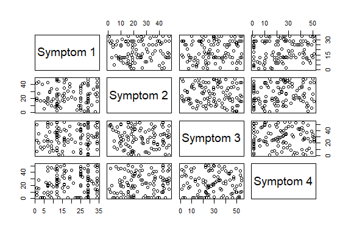
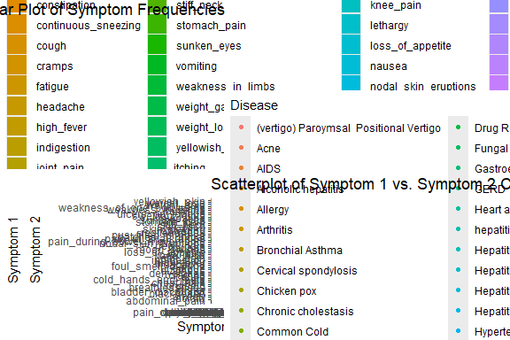

Disease Symptoms Prediction
================
Trevor Okinda
2024

- [Student Details](#student-details)
- [Setup Chunk](#setup-chunk)
  - [Source:](#source)
  - [Reference:](#reference)
- [Exploratory Data Analysis](#exploratory-data-analysis)
  - [Load dataset](#load-dataset)
  - [Measures of Frequency](#measures-of-frequency)
  - [Measures of Central Tendency](#measures-of-central-tendency)
  - [Measures of Relationship](#measures-of-relationship)
  - [Plots](#plots)
- [Preprocessing and Data
  Transformation](#preprocessing-and-data-transformation)
  - [Missing Values](#missing-values)
- [Model Training](#model-training)
  - [Data Splitting](#data-splitting)

# Student Details

|                       |                             |
|-----------------------|-----------------------------|
| **Student ID Number** | 134780                      |
| **Student Name**      | Trevor Okinda               |
| **BBIT 4.2 Group**    | C                           |
| **Project Name**      | Disease Symptoms Prediction |

# Setup Chunk

**Note:** the following KnitR options have been set as the global
defaults: <BR>
`knitr::opts_chunk$set(echo = TRUE, warning = FALSE, eval = TRUE, collapse = FALSE, tidy = TRUE)`.

More KnitR options are documented here
<https://bookdown.org/yihui/rmarkdown-cookbook/chunk-options.html> and
here <https://yihui.org/knitr/options/>.

### Source:

The dataset that was used can be downloaded here: *\<<a
href="https://www.kaggle.com/datasets/itachi9604/disease-symptom-description-dataset?select=dataset.csv\"
class="uri">https://www.kaggle.com/datasets/itachi9604/disease-symptom-description-dataset?select=dataset.csv\</a>\>*

### Reference:

*\<itachi9604. (n.d.). Disease Symptom Description Dataset. Kaggle.
Retrieved April 17, 2025, from <a
href="https://www.kaggle.com/datasets/itachi9604/disease-symptom-description-dataset\"
class="uri">https://www.kaggle.com/datasets/itachi9604/disease-symptom-description-dataset\</a>\>  
Refer to the APA 7th edition manual for rules on how to cite datasets:
<https://apastyle.apa.org/style-grammar-guidelines/references/examples/data-set-references>*

# Exploratory Data Analysis

## Load dataset

``` r
# Load dataset
your_data <- read.csv("dataset.csv", colClasses = c(
  Disease = "factor",
  Symptom_1 = "factor",
  Symptom_2 = "factor",
  Symptom_3 = "factor",
  Symptom_4 = "factor"
))

# Display the structure of the dataset
str(your_data)
```

    ## 'data.frame':    4920 obs. of  5 variables:
    ##  $ Disease  : Factor w/ 41 levels "(vertigo) Paroymsal  Positional Vertigo",..: 16 16 16 16 16 16 16 16 16 16 ...
    ##  $ Symptom_1: Factor w/ 34 levels " acidity"," back_pain",..: 34 25 34 34 34 25 34 34 34 34 ...
    ##  $ Symptom_2: Factor w/ 48 levels " abdominal_pain",..: 36 28 28 36 36 28 28 36 36 36 ...
    ##  $ Symptom_3: Factor w/ 54 levels " abdominal_pain",..: 36 19 19 19 36 19 19 19 36 36 ...
    ##  $ Symptom_4: Factor w/ 51 levels ""," abdominal_pain",..: 13 1 1 1 1 1 1 1 1 13 ...

``` r
# View the first few rows of the dataset
head(your_data)
```

    ##            Disease  Symptom_1             Symptom_2             Symptom_3
    ## 1 Fungal infection    itching             skin_rash  nodal_skin_eruptions
    ## 2 Fungal infection  skin_rash  nodal_skin_eruptions   dischromic _patches
    ## 3 Fungal infection    itching  nodal_skin_eruptions   dischromic _patches
    ## 4 Fungal infection    itching             skin_rash   dischromic _patches
    ## 5 Fungal infection    itching             skin_rash  nodal_skin_eruptions
    ## 6 Fungal infection  skin_rash  nodal_skin_eruptions   dischromic _patches
    ##              Symptom_4
    ## 1  dischromic _patches
    ## 2                     
    ## 3                     
    ## 4                     
    ## 5                     
    ## 6

``` r
# View the dataset in a separate viewer window
View(your_data)
```

## Measures of Frequency

``` r
# Measures of Frequency
# Frequency of each disease
disease_frequency <- table(your_data$Disease)

# Frequency of each symptom
symptom1_frequency <- table(your_data$Symptom_1)
symptom2_frequency <- table(your_data$Symptom_2)
symptom3_frequency <- table(your_data$Symptom_3)
symptom4_frequency <- table(your_data$Symptom_4)
```

## Measures of Central Tendency

``` r
# Measures of Central Tendency
# No central tendency measures are applicable for disease or symptom variables

# Measures of Distribution
# No distribution measures are applicable for disease or symptom variables
```

## Measures of Relationship

``` r
# Measures of Relationship
# Association between disease and symptom 1
association_symptom1 <- table(your_data$Disease, your_data$Symptom_1)

# Association between disease and symptom 2
association_symptom2 <- table(your_data$Disease, your_data$Symptom_2)

# Association between disease and symptom 3
association_symptom3 <- table(your_data$Disease, your_data$Symptom_3)

# Association between disease and symptom 4
association_symptom4 <- table(your_data$Disease, your_data$Symptom_4)

# Output Measures of Frequency
print("Frequency of each disease:")
```

    ## [1] "Frequency of each disease:"

``` r
print(disease_frequency)
```

    ## 
    ## (vertigo) Paroymsal  Positional Vertigo                                    Acne 
    ##                                     120                                     120 
    ##                                    AIDS                     Alcoholic hepatitis 
    ##                                     120                                     120 
    ##                                 Allergy                               Arthritis 
    ##                                     120                                     120 
    ##                        Bronchial Asthma                    Cervical spondylosis 
    ##                                     120                                     120 
    ##                             Chicken pox                     Chronic cholestasis 
    ##                                     120                                     120 
    ##                             Common Cold                                  Dengue 
    ##                                     120                                     120 
    ##                               Diabetes             Dimorphic hemmorhoids(piles) 
    ##                                     120                                     120 
    ##                           Drug Reaction                        Fungal infection 
    ##                                     120                                     120 
    ##                         Gastroenteritis                                    GERD 
    ##                                     120                                     120 
    ##                            Heart attack                             hepatitis A 
    ##                                     120                                     120 
    ##                             Hepatitis B                             Hepatitis C 
    ##                                     120                                     120 
    ##                             Hepatitis D                             Hepatitis E 
    ##                                     120                                     120 
    ##                           Hypertension                          Hyperthyroidism 
    ##                                     120                                     120 
    ##                            Hypoglycemia                          Hypothyroidism 
    ##                                     120                                     120 
    ##                                Impetigo                                Jaundice 
    ##                                     120                                     120 
    ##                                 Malaria                                Migraine 
    ##                                     120                                     120 
    ##                         Osteoarthristis            Paralysis (brain hemorrhage) 
    ##                                     120                                     120 
    ##                     Peptic ulcer diseae                               Pneumonia 
    ##                                     120                                     120 
    ##                               Psoriasis                            Tuberculosis 
    ##                                     120                                     120 
    ##                                 Typhoid                 Urinary tract infection 
    ##                                     120                                     120 
    ##                          Varicose veins 
    ##                                     120

``` r
print("Frequency of Symptom 1:")
```

    ## [1] "Frequency of Symptom 1:"

``` r
print(symptom1_frequency)
```

    ## 
    ##                      acidity                    back_pain 
    ##                          120                          108 
    ##           bladder_discomfort               breathlessness 
    ##                           12                           12 
    ##          burning_micturition                   chest_pain 
    ##                          108                           12 
    ##                       chills                 constipation 
    ##                          474                          114 
    ##          continuous_sneezing                        cough 
    ##                          222                           12 
    ##                       cramps                      fatigue 
    ##                            6                          690 
    ##                     headache                   high_fever 
    ##                          126                            6 
    ##                  indigestion                   joint_pain 
    ##                           12                          462 
    ##                  mood_swings               muscle_wasting 
    ##                            6                          108 
    ##              muscle_weakness                    neck_pain 
    ##                          114                            6 
    ##  pain_during_bowel_movements            patches_in_throat 
    ##                            6                           12 
    ##           pus_filled_pimples                    shivering 
    ##                            6                           12 
    ##                    skin_rash                   stiff_neck 
    ##                          480                            6 
    ##                 stomach_pain                  sunken_eyes 
    ##                          114                           12 
    ##                     vomiting            weakness_in_limbs 
    ##                          822                           12 
    ##                  weight_gain                  weight_loss 
    ##                           12                            6 
    ##               yellowish_skin                      itching 
    ##                           12                          678

``` r
print("Frequency of Symptom 2:")
```

    ## [1] "Frequency of Symptom 2:"

``` r
print(symptom2_frequency)
```

    ## 
    ##               abdominal_pain                      acidity 
    ##                           12                          102 
    ##                      anxiety                   blackheads 
    ##                           12                           18 
    ##           bladder_discomfort                      blister 
    ##                          102                           24 
    ##               breathlessness                     bruising 
    ##                           96                           12 
    ##                   chest_pain                       chills 
    ##                           96                          240 
    ##         cold_hands_and_feets                        cough 
    ##                           18                          108 
    ##                       cramps                  dehydration 
    ##                          108                           24 
    ##                    dizziness                      fatigue 
    ##                           24                          402 
    ##          foul_smell_of urine                     headache 
    ##                           18                          216 
    ##                   high_fever                  indigestion 
    ##                          156                          210 
    ##                   joint_pain                    knee_pain 
    ##                          120                           12 
    ##                     lethargy             loss_of_appetite 
    ##                           12                           18 
    ##                  mood_swings                       nausea 
    ##                          108                           24 
    ##                    neck_pain         nodal_skin_eruptions 
    ##                          132                           24 
    ##  pain_during_bowel_movements          pain_in_anal_region 
    ##                          108                           12 
    ##            patches_in_throat           pus_filled_pimples 
    ##                           96                          102 
    ##                 restlessness                    shivering 
    ##                           12                           96 
    ##                 skin_peeling                    skin_rash 
    ##                           12                          306 
    ##                   stiff_neck                 stomach_pain 
    ##                          108                           18 
    ##                  sunken_eyes                     sweating 
    ##                           96                           24 
    ##              swelling_joints             ulcers_on_tongue 
    ##                           12                           18 
    ##                     vomiting            weakness_in_limbs 
    ##                          870                           96 
    ##    weakness_of_one_body_side                  weight_gain 
    ##                           24                          102 
    ##                  weight_loss               yellowish_skin 
    ##                          120                          240

``` r
print("Frequency of Symptom 3:")
```

    ## [1] "Frequency of Symptom 3:"

``` r
print(symptom3_frequency)
```

    ## 
    ##                abdominal_pain             altered_sensorium 
    ##                           132                            36 
    ##                       anxiety                    blackheads 
    ##                           102                            90 
    ##                       blister                  bloody_stool 
    ##                            90                            18 
    ##  blurred_and_distorted_vision                breathlessness 
    ##                            18                            30 
    ##                      bruising           burning_micturition 
    ##                           102                            30 
    ##                    chest_pain                        chills 
    ##                            36                            84 
    ##          cold_hands_and_feets      continuous_feel_of_urine 
    ##                            96                            36 
    ##                         cough                    dark_urine 
    ##                           120                            18 
    ##                   dehydration                     diarrhoea 
    ##                            84                            36 
    ##           dischromic _patches                     dizziness 
    ##                            36                           114 
    ##        extra_marital_contacts                       fatigue 
    ##                            30                           726 
    ##           foul_smell_of urine                      headache 
    ##                            84                           102 
    ##                    high_fever                hip_joint_pain 
    ##                           324                            18 
    ##                    joint_pain                     knee_pain 
    ##                           102                           102 
    ##                      lethargy              loss_of_appetite 
    ##                           138                           108 
    ##               loss_of_balance                   mood_swings 
    ##                            36                            24 
    ##            movement_stiffness                        nausea 
    ##                            18                           222 
    ##                     neck_pain          nodal_skin_eruptions 
    ##                            90                            84 
    ##                       obesity           pain_in_anal_region 
    ##                            18                           102 
    ##          red_sore_around_nose                  restlessness 
    ##                            30                           120 
    ##                      scurring           silver_like_dusting 
    ##                            30                            18 
    ##                  skin_peeling            spinning_movements 
    ##                           102                            18 
    ##                  stomach_pain                      sweating 
    ##                            90                           120 
    ##               swelling_joints           swelling_of_stomach 
    ##                           102                            18 
    ##              ulcers_on_tongue                      vomiting 
    ##                            90                            48 
    ##            watering_from_eyes     weakness_of_one_body_side 
    ##                            36                            84 
    ##                   weight_loss                yellowish_skin 
    ##                           138                           240

``` r
print("Frequency of Symptom 4:")
```

    ## [1] "Frequency of Symptom 4:"

``` r
print(symptom4_frequency)
```

    ## 
    ##                                              abdominal_pain 
    ##                           348                            84 
    ##             altered_sensorium                  bloody_stool 
    ##                            78                            96 
    ##  blurred_and_distorted_vision                breathlessness 
    ##                            96                           108 
    ##           burning_micturition                    chest_pain 
    ##                            78                            78 
    ##      continuous_feel_of_urine                         cough 
    ##                            78                           162 
    ##                    dark_urine                     diarrhoea 
    ##                           144                            78 
    ##           dischromic _patches         distention_of_abdomen 
    ##                            72                            24 
    ##                     dizziness              excessive_hunger 
    ##                            84                            24 
    ##        extra_marital_contacts                family_history 
    ##                            78                            36 
    ##                       fatigue                      headache 
    ##                            24                            54 
    ##                    high_fever                hip_joint_pain 
    ##                           378                            96 
    ##         irregular_sugar_level            irritation_in_anus 
    ##                            24                            24 
    ##         lack_of_concentration                      lethargy 
    ##                            42                           222 
    ##              loss_of_appetite               loss_of_balance 
    ##                           120                           144 
    ##                   mood_swings            movement_stiffness 
    ##                            90                            96 
    ##                        nausea                       obesity 
    ##                           120                            96 
    ##               painful_walking              passage_of_gases 
    ##                            24                            36 
    ##          red_sore_around_nose                  restlessness 
    ##                            84                            96 
    ##                      scurring           silver_like_dusting 
    ##                            78                            96 
    ##          small_dents_in_nails            spinning_movements 
    ##                            24                            90 
    ##           spotting_ urination                      sweating 
    ##                            42                           216 
    ##               swelling_joints           swelling_of_stomach 
    ##                            24                            96 
    ##                  swollen_legs                      vomiting 
    ##                            24                           174 
    ##            watering_from_eyes                   weight_loss 
    ##                            72                           192 
    ##             yellow_crust_ooze             yellowing_of_eyes 
    ##                            36                            24 
    ##                yellowish_skin 
    ##                           216

``` r
# Output Measures of Relationship
print("Association between Disease and Symptom 1:")
```

    ## [1] "Association between Disease and Symptom 1:"

``` r
print(association_symptom1)
```

    ##                                          
    ##                                            acidity  back_pain
    ##   (vertigo) Paroymsal  Positional Vertigo        0          0
    ##   Acne                                           0          0
    ##   AIDS                                           0          0
    ##   Alcoholic hepatitis                            0          0
    ##   Allergy                                        0          0
    ##   Arthritis                                      0          0
    ##   Bronchial Asthma                               0          0
    ##   Cervical spondylosis                           0        108
    ##   Chicken pox                                    0          0
    ##   Chronic cholestasis                            0          0
    ##   Common Cold                                    0          0
    ##   Dengue                                         0          0
    ##   Diabetes                                       0          0
    ##   Dimorphic hemmorhoids(piles)                   0          0
    ##   Drug Reaction                                  0          0
    ##   Fungal infection                               0          0
    ##   Gastroenteritis                                0          0
    ##   GERD                                           6          0
    ##   Heart attack                                   0          0
    ##   hepatitis A                                    0          0
    ##   Hepatitis B                                    0          0
    ##   Hepatitis C                                    0          0
    ##   Hepatitis D                                    0          0
    ##   Hepatitis E                                    0          0
    ##   Hypertension                                   0          0
    ##   Hyperthyroidism                                0          0
    ##   Hypoglycemia                                   0          0
    ##   Hypothyroidism                                 0          0
    ##   Impetigo                                       0          0
    ##   Jaundice                                       0          0
    ##   Malaria                                        0          0
    ##   Migraine                                     114          0
    ##   Osteoarthristis                                0          0
    ##   Paralysis (brain hemorrhage)                   0          0
    ##   Peptic ulcer diseae                            0          0
    ##   Pneumonia                                      0          0
    ##   Psoriasis                                      0          0
    ##   Tuberculosis                                   0          0
    ##   Typhoid                                        0          0
    ##   Urinary tract infection                        0          0
    ##   Varicose veins                                 0          0
    ##                                          
    ##                                            bladder_discomfort  breathlessness
    ##   (vertigo) Paroymsal  Positional Vertigo                   0               0
    ##   Acne                                                      0               0
    ##   AIDS                                                      0               0
    ##   Alcoholic hepatitis                                       0               0
    ##   Allergy                                                   0               0
    ##   Arthritis                                                 0               0
    ##   Bronchial Asthma                                          0               0
    ##   Cervical spondylosis                                      0               0
    ##   Chicken pox                                               0               0
    ##   Chronic cholestasis                                       0               0
    ##   Common Cold                                               0               0
    ##   Dengue                                                    0               0
    ##   Diabetes                                                  0               0
    ##   Dimorphic hemmorhoids(piles)                              0               0
    ##   Drug Reaction                                             0               0
    ##   Fungal infection                                          0               0
    ##   Gastroenteritis                                           0               0
    ##   GERD                                                      0               0
    ##   Heart attack                                              0              12
    ##   hepatitis A                                               0               0
    ##   Hepatitis B                                               0               0
    ##   Hepatitis C                                               0               0
    ##   Hepatitis D                                               0               0
    ##   Hepatitis E                                               0               0
    ##   Hypertension                                              0               0
    ##   Hyperthyroidism                                           0               0
    ##   Hypoglycemia                                              0               0
    ##   Hypothyroidism                                            0               0
    ##   Impetigo                                                  0               0
    ##   Jaundice                                                  0               0
    ##   Malaria                                                   0               0
    ##   Migraine                                                  0               0
    ##   Osteoarthristis                                           0               0
    ##   Paralysis (brain hemorrhage)                              0               0
    ##   Peptic ulcer diseae                                       0               0
    ##   Pneumonia                                                 0               0
    ##   Psoriasis                                                 0               0
    ##   Tuberculosis                                              0               0
    ##   Typhoid                                                   0               0
    ##   Urinary tract infection                                  12               0
    ##   Varicose veins                                            0               0
    ##                                          
    ##                                            burning_micturition  chest_pain
    ##   (vertigo) Paroymsal  Positional Vertigo                    0           0
    ##   Acne                                                       0           0
    ##   AIDS                                                       0           0
    ##   Alcoholic hepatitis                                        0           0
    ##   Allergy                                                    0           0
    ##   Arthritis                                                  0           0
    ##   Bronchial Asthma                                           0           0
    ##   Cervical spondylosis                                       0           0
    ##   Chicken pox                                                0           0
    ##   Chronic cholestasis                                        0           0
    ##   Common Cold                                                0           0
    ##   Dengue                                                     0           0
    ##   Diabetes                                                   0           0
    ##   Dimorphic hemmorhoids(piles)                               0           0
    ##   Drug Reaction                                              0           0
    ##   Fungal infection                                           0           0
    ##   Gastroenteritis                                            0           0
    ##   GERD                                                       0           0
    ##   Heart attack                                               0           0
    ##   hepatitis A                                                0           0
    ##   Hepatitis B                                                0           0
    ##   Hepatitis C                                                0           0
    ##   Hepatitis D                                                0           0
    ##   Hepatitis E                                                0           0
    ##   Hypertension                                               0          12
    ##   Hyperthyroidism                                            0           0
    ##   Hypoglycemia                                               0           0
    ##   Hypothyroidism                                             0           0
    ##   Impetigo                                                   0           0
    ##   Jaundice                                                   0           0
    ##   Malaria                                                    0           0
    ##   Migraine                                                   0           0
    ##   Osteoarthristis                                            0           0
    ##   Paralysis (brain hemorrhage)                               0           0
    ##   Peptic ulcer diseae                                        0           0
    ##   Pneumonia                                                  0           0
    ##   Psoriasis                                                  0           0
    ##   Tuberculosis                                               0           0
    ##   Typhoid                                                    0           0
    ##   Urinary tract infection                                  108           0
    ##   Varicose veins                                             0           0
    ##                                          
    ##                                            chills  constipation
    ##   (vertigo) Paroymsal  Positional Vertigo       0             0
    ##   Acne                                          0             0
    ##   AIDS                                          0             0
    ##   Alcoholic hepatitis                           0             0
    ##   Allergy                                       0             0
    ##   Arthritis                                     0             0
    ##   Bronchial Asthma                              0             0
    ##   Cervical spondylosis                          0             0
    ##   Chicken pox                                   0             0
    ##   Chronic cholestasis                           0             0
    ##   Common Cold                                   6             0
    ##   Dengue                                        6             0
    ##   Diabetes                                      0             0
    ##   Dimorphic hemmorhoids(piles)                  0           114
    ##   Drug Reaction                                 0             0
    ##   Fungal infection                              0             0
    ##   Gastroenteritis                               0             0
    ##   GERD                                          0             0
    ##   Heart attack                                  0             0
    ##   hepatitis A                                   0             0
    ##   Hepatitis B                                   0             0
    ##   Hepatitis C                                   0             0
    ##   Hepatitis D                                   0             0
    ##   Hepatitis E                                   0             0
    ##   Hypertension                                  0             0
    ##   Hyperthyroidism                               0             0
    ##   Hypoglycemia                                  0             0
    ##   Hypothyroidism                                0             0
    ##   Impetigo                                      0             0
    ##   Jaundice                                      0             0
    ##   Malaria                                     114             0
    ##   Migraine                                      0             0
    ##   Osteoarthristis                               0             0
    ##   Paralysis (brain hemorrhage)                  0             0
    ##   Peptic ulcer diseae                           0             0
    ##   Pneumonia                                   114             0
    ##   Psoriasis                                     0             0
    ##   Tuberculosis                                114             0
    ##   Typhoid                                     120             0
    ##   Urinary tract infection                       0             0
    ##   Varicose veins                                0             0
    ##                                          
    ##                                            continuous_sneezing  cough  cramps
    ##   (vertigo) Paroymsal  Positional Vertigo                    0      0       0
    ##   Acne                                                       0      0       0
    ##   AIDS                                                       0      0       0
    ##   Alcoholic hepatitis                                        0      0       0
    ##   Allergy                                                  108      0       0
    ##   Arthritis                                                  0      0       0
    ##   Bronchial Asthma                                           0     12       0
    ##   Cervical spondylosis                                       0      0       0
    ##   Chicken pox                                                0      0       0
    ##   Chronic cholestasis                                        0      0       0
    ##   Common Cold                                              114      0       0
    ##   Dengue                                                     0      0       0
    ##   Diabetes                                                   0      0       0
    ##   Dimorphic hemmorhoids(piles)                               0      0       0
    ##   Drug Reaction                                              0      0       0
    ##   Fungal infection                                           0      0       0
    ##   Gastroenteritis                                            0      0       0
    ##   GERD                                                       0      0       0
    ##   Heart attack                                               0      0       0
    ##   hepatitis A                                                0      0       0
    ##   Hepatitis B                                                0      0       0
    ##   Hepatitis C                                                0      0       0
    ##   Hepatitis D                                                0      0       0
    ##   Hepatitis E                                                0      0       0
    ##   Hypertension                                               0      0       0
    ##   Hyperthyroidism                                            0      0       0
    ##   Hypoglycemia                                               0      0       0
    ##   Hypothyroidism                                             0      0       0
    ##   Impetigo                                                   0      0       0
    ##   Jaundice                                                   0      0       0
    ##   Malaria                                                    0      0       0
    ##   Migraine                                                   0      0       0
    ##   Osteoarthristis                                            0      0       0
    ##   Paralysis (brain hemorrhage)                               0      0       0
    ##   Peptic ulcer diseae                                        0      0       0
    ##   Pneumonia                                                  0      0       0
    ##   Psoriasis                                                  0      0       0
    ##   Tuberculosis                                               0      0       0
    ##   Typhoid                                                    0      0       0
    ##   Urinary tract infection                                    0      0       0
    ##   Varicose veins                                             0      0       6
    ##                                          
    ##                                            fatigue  headache  high_fever
    ##   (vertigo) Paroymsal  Positional Vertigo        0         6           0
    ##   Acne                                           0         0           0
    ##   AIDS                                           0         0           0
    ##   Alcoholic hepatitis                            0         0           0
    ##   Allergy                                        0         0           0
    ##   Arthritis                                      0         0           0
    ##   Bronchial Asthma                             108         0           0
    ##   Cervical spondylosis                           0         0           0
    ##   Chicken pox                                    0         0           0
    ##   Chronic cholestasis                            0         0           0
    ##   Common Cold                                    0         0           0
    ##   Dengue                                         0         0           0
    ##   Diabetes                                     114         0           0
    ##   Dimorphic hemmorhoids(piles)                   0         0           0
    ##   Drug Reaction                                  0         0           0
    ##   Fungal infection                               0         0           0
    ##   Gastroenteritis                                0         0           0
    ##   GERD                                           0         0           0
    ##   Heart attack                                   0         0           0
    ##   hepatitis A                                    0         0           0
    ##   Hepatitis B                                    6         0           0
    ##   Hepatitis C                                  114         0           0
    ##   Hepatitis D                                    0         0           0
    ##   Hepatitis E                                    0         0           0
    ##   Hypertension                                   0       108           0
    ##   Hyperthyroidism                              114         0           0
    ##   Hypoglycemia                                   6         0           0
    ##   Hypothyroidism                               108         0           0
    ##   Impetigo                                       0         0           6
    ##   Jaundice                                       0         0           0
    ##   Malaria                                        0         0           0
    ##   Migraine                                       0         0           0
    ##   Osteoarthristis                                0         0           0
    ##   Paralysis (brain hemorrhage)                   0        12           0
    ##   Peptic ulcer diseae                            0         0           0
    ##   Pneumonia                                      6         0           0
    ##   Psoriasis                                      0         0           0
    ##   Tuberculosis                                   0         0           0
    ##   Typhoid                                        0         0           0
    ##   Urinary tract infection                        0         0           0
    ##   Varicose veins                               114         0           0
    ##                                          
    ##                                            indigestion  joint_pain  mood_swings
    ##   (vertigo) Paroymsal  Positional Vertigo            0           0            0
    ##   Acne                                               0           0            0
    ##   AIDS                                               0           0            0
    ##   Alcoholic hepatitis                                0           0            0
    ##   Allergy                                            0           0            0
    ##   Arthritis                                          0           0            0
    ##   Bronchial Asthma                                   0           0            0
    ##   Cervical spondylosis                               0           0            0
    ##   Chicken pox                                        0           0            0
    ##   Chronic cholestasis                                0           0            0
    ##   Common Cold                                        0           0            0
    ##   Dengue                                             0           0            0
    ##   Diabetes                                           0           0            0
    ##   Dimorphic hemmorhoids(piles)                       0           0            0
    ##   Drug Reaction                                      0           0            0
    ##   Fungal infection                                   0           0            0
    ##   Gastroenteritis                                    0           0            0
    ##   GERD                                               0           0            0
    ##   Heart attack                                       0           0            0
    ##   hepatitis A                                        0         114            0
    ##   Hepatitis B                                        0           0            0
    ##   Hepatitis C                                        0           0            0
    ##   Hepatitis D                                        0         114            0
    ##   Hepatitis E                                        0         114            0
    ##   Hypertension                                       0           0            0
    ##   Hyperthyroidism                                    0           0            6
    ##   Hypoglycemia                                       0           0            0
    ##   Hypothyroidism                                     0           0            0
    ##   Impetigo                                           0           0            0
    ##   Jaundice                                           0           0            0
    ##   Malaria                                            0           0            0
    ##   Migraine                                           6           0            0
    ##   Osteoarthristis                                    0         114            0
    ##   Paralysis (brain hemorrhage)                       0           0            0
    ##   Peptic ulcer diseae                                6           0            0
    ##   Pneumonia                                          0           0            0
    ##   Psoriasis                                          0           6            0
    ##   Tuberculosis                                       0           0            0
    ##   Typhoid                                            0           0            0
    ##   Urinary tract infection                            0           0            0
    ##   Varicose veins                                     0           0            0
    ##                                          
    ##                                            muscle_wasting  muscle_weakness
    ##   (vertigo) Paroymsal  Positional Vertigo               0                0
    ##   Acne                                                  0                0
    ##   AIDS                                                108                0
    ##   Alcoholic hepatitis                                   0                0
    ##   Allergy                                               0                0
    ##   Arthritis                                             0              114
    ##   Bronchial Asthma                                      0                0
    ##   Cervical spondylosis                                  0                0
    ##   Chicken pox                                           0                0
    ##   Chronic cholestasis                                   0                0
    ##   Common Cold                                           0                0
    ##   Dengue                                                0                0
    ##   Diabetes                                              0                0
    ##   Dimorphic hemmorhoids(piles)                          0                0
    ##   Drug Reaction                                         0                0
    ##   Fungal infection                                      0                0
    ##   Gastroenteritis                                       0                0
    ##   GERD                                                  0                0
    ##   Heart attack                                          0                0
    ##   hepatitis A                                           0                0
    ##   Hepatitis B                                           0                0
    ##   Hepatitis C                                           0                0
    ##   Hepatitis D                                           0                0
    ##   Hepatitis E                                           0                0
    ##   Hypertension                                          0                0
    ##   Hyperthyroidism                                       0                0
    ##   Hypoglycemia                                          0                0
    ##   Hypothyroidism                                        0                0
    ##   Impetigo                                              0                0
    ##   Jaundice                                              0                0
    ##   Malaria                                               0                0
    ##   Migraine                                              0                0
    ##   Osteoarthristis                                       0                0
    ##   Paralysis (brain hemorrhage)                          0                0
    ##   Peptic ulcer diseae                                   0                0
    ##   Pneumonia                                             0                0
    ##   Psoriasis                                             0                0
    ##   Tuberculosis                                          0                0
    ##   Typhoid                                               0                0
    ##   Urinary tract infection                               0                0
    ##   Varicose veins                                        0                0
    ##                                          
    ##                                            neck_pain
    ##   (vertigo) Paroymsal  Positional Vertigo          0
    ##   Acne                                             0
    ##   AIDS                                             0
    ##   Alcoholic hepatitis                              0
    ##   Allergy                                          0
    ##   Arthritis                                        0
    ##   Bronchial Asthma                                 0
    ##   Cervical spondylosis                             0
    ##   Chicken pox                                      0
    ##   Chronic cholestasis                              0
    ##   Common Cold                                      0
    ##   Dengue                                           0
    ##   Diabetes                                         0
    ##   Dimorphic hemmorhoids(piles)                     0
    ##   Drug Reaction                                    0
    ##   Fungal infection                                 0
    ##   Gastroenteritis                                  0
    ##   GERD                                             0
    ##   Heart attack                                     0
    ##   hepatitis A                                      0
    ##   Hepatitis B                                      0
    ##   Hepatitis C                                      0
    ##   Hepatitis D                                      0
    ##   Hepatitis E                                      0
    ##   Hypertension                                     0
    ##   Hyperthyroidism                                  0
    ##   Hypoglycemia                                     0
    ##   Hypothyroidism                                   0
    ##   Impetigo                                         0
    ##   Jaundice                                         0
    ##   Malaria                                          0
    ##   Migraine                                         0
    ##   Osteoarthristis                                  6
    ##   Paralysis (brain hemorrhage)                     0
    ##   Peptic ulcer diseae                              0
    ##   Pneumonia                                        0
    ##   Psoriasis                                        0
    ##   Tuberculosis                                     0
    ##   Typhoid                                          0
    ##   Urinary tract infection                          0
    ##   Varicose veins                                   0
    ##                                          
    ##                                            pain_during_bowel_movements
    ##   (vertigo) Paroymsal  Positional Vertigo                            0
    ##   Acne                                                               0
    ##   AIDS                                                               0
    ##   Alcoholic hepatitis                                                0
    ##   Allergy                                                            0
    ##   Arthritis                                                          0
    ##   Bronchial Asthma                                                   0
    ##   Cervical spondylosis                                               0
    ##   Chicken pox                                                        0
    ##   Chronic cholestasis                                                0
    ##   Common Cold                                                        0
    ##   Dengue                                                             0
    ##   Diabetes                                                           0
    ##   Dimorphic hemmorhoids(piles)                                       6
    ##   Drug Reaction                                                      0
    ##   Fungal infection                                                   0
    ##   Gastroenteritis                                                    0
    ##   GERD                                                               0
    ##   Heart attack                                                       0
    ##   hepatitis A                                                        0
    ##   Hepatitis B                                                        0
    ##   Hepatitis C                                                        0
    ##   Hepatitis D                                                        0
    ##   Hepatitis E                                                        0
    ##   Hypertension                                                       0
    ##   Hyperthyroidism                                                    0
    ##   Hypoglycemia                                                       0
    ##   Hypothyroidism                                                     0
    ##   Impetigo                                                           0
    ##   Jaundice                                                           0
    ##   Malaria                                                            0
    ##   Migraine                                                           0
    ##   Osteoarthristis                                                    0
    ##   Paralysis (brain hemorrhage)                                       0
    ##   Peptic ulcer diseae                                                0
    ##   Pneumonia                                                          0
    ##   Psoriasis                                                          0
    ##   Tuberculosis                                                       0
    ##   Typhoid                                                            0
    ##   Urinary tract infection                                            0
    ##   Varicose veins                                                     0
    ##                                          
    ##                                            patches_in_throat
    ##   (vertigo) Paroymsal  Positional Vertigo                  0
    ##   Acne                                                     0
    ##   AIDS                                                    12
    ##   Alcoholic hepatitis                                      0
    ##   Allergy                                                  0
    ##   Arthritis                                                0
    ##   Bronchial Asthma                                         0
    ##   Cervical spondylosis                                     0
    ##   Chicken pox                                              0
    ##   Chronic cholestasis                                      0
    ##   Common Cold                                              0
    ##   Dengue                                                   0
    ##   Diabetes                                                 0
    ##   Dimorphic hemmorhoids(piles)                             0
    ##   Drug Reaction                                            0
    ##   Fungal infection                                         0
    ##   Gastroenteritis                                          0
    ##   GERD                                                     0
    ##   Heart attack                                             0
    ##   hepatitis A                                              0
    ##   Hepatitis B                                              0
    ##   Hepatitis C                                              0
    ##   Hepatitis D                                              0
    ##   Hepatitis E                                              0
    ##   Hypertension                                             0
    ##   Hyperthyroidism                                          0
    ##   Hypoglycemia                                             0
    ##   Hypothyroidism                                           0
    ##   Impetigo                                                 0
    ##   Jaundice                                                 0
    ##   Malaria                                                  0
    ##   Migraine                                                 0
    ##   Osteoarthristis                                          0
    ##   Paralysis (brain hemorrhage)                             0
    ##   Peptic ulcer diseae                                      0
    ##   Pneumonia                                                0
    ##   Psoriasis                                                0
    ##   Tuberculosis                                             0
    ##   Typhoid                                                  0
    ##   Urinary tract infection                                  0
    ##   Varicose veins                                           0
    ##                                          
    ##                                            pus_filled_pimples  shivering
    ##   (vertigo) Paroymsal  Positional Vertigo                   0          0
    ##   Acne                                                      6          0
    ##   AIDS                                                      0          0
    ##   Alcoholic hepatitis                                       0          0
    ##   Allergy                                                   0         12
    ##   Arthritis                                                 0          0
    ##   Bronchial Asthma                                          0          0
    ##   Cervical spondylosis                                      0          0
    ##   Chicken pox                                               0          0
    ##   Chronic cholestasis                                       0          0
    ##   Common Cold                                               0          0
    ##   Dengue                                                    0          0
    ##   Diabetes                                                  0          0
    ##   Dimorphic hemmorhoids(piles)                              0          0
    ##   Drug Reaction                                             0          0
    ##   Fungal infection                                          0          0
    ##   Gastroenteritis                                           0          0
    ##   GERD                                                      0          0
    ##   Heart attack                                              0          0
    ##   hepatitis A                                               0          0
    ##   Hepatitis B                                               0          0
    ##   Hepatitis C                                               0          0
    ##   Hepatitis D                                               0          0
    ##   Hepatitis E                                               0          0
    ##   Hypertension                                              0          0
    ##   Hyperthyroidism                                           0          0
    ##   Hypoglycemia                                              0          0
    ##   Hypothyroidism                                            0          0
    ##   Impetigo                                                  0          0
    ##   Jaundice                                                  0          0
    ##   Malaria                                                   0          0
    ##   Migraine                                                  0          0
    ##   Osteoarthristis                                           0          0
    ##   Paralysis (brain hemorrhage)                              0          0
    ##   Peptic ulcer diseae                                       0          0
    ##   Pneumonia                                                 0          0
    ##   Psoriasis                                                 0          0
    ##   Tuberculosis                                              0          0
    ##   Typhoid                                                   0          0
    ##   Urinary tract infection                                   0          0
    ##   Varicose veins                                            0          0
    ##                                          
    ##                                            skin_rash  stiff_neck  stomach_pain
    ##   (vertigo) Paroymsal  Positional Vertigo          0           0             0
    ##   Acne                                           114           0             0
    ##   AIDS                                             0           0             0
    ##   Alcoholic hepatitis                              0           0             0
    ##   Allergy                                          0           0             0
    ##   Arthritis                                        0           6             0
    ##   Bronchial Asthma                                 0           0             0
    ##   Cervical spondylosis                             0           0             0
    ##   Chicken pox                                      6           0             0
    ##   Chronic cholestasis                              0           0             0
    ##   Common Cold                                      0           0             0
    ##   Dengue                                         114           0             0
    ##   Diabetes                                         0           0             0
    ##   Dimorphic hemmorhoids(piles)                     0           0             0
    ##   Drug Reaction                                    6           0             0
    ##   Fungal infection                                12           0             0
    ##   Gastroenteritis                                  0           0             0
    ##   GERD                                             0           0           114
    ##   Heart attack                                     0           0             0
    ##   hepatitis A                                      0           0             0
    ##   Hepatitis B                                      0           0             0
    ##   Hepatitis C                                      0           0             0
    ##   Hepatitis D                                      0           0             0
    ##   Hepatitis E                                      0           0             0
    ##   Hypertension                                     0           0             0
    ##   Hyperthyroidism                                  0           0             0
    ##   Hypoglycemia                                     0           0             0
    ##   Hypothyroidism                                   0           0             0
    ##   Impetigo                                       114           0             0
    ##   Jaundice                                         0           0             0
    ##   Malaria                                          0           0             0
    ##   Migraine                                         0           0             0
    ##   Osteoarthristis                                  0           0             0
    ##   Paralysis (brain hemorrhage)                     0           0             0
    ##   Peptic ulcer diseae                              0           0             0
    ##   Pneumonia                                        0           0             0
    ##   Psoriasis                                      114           0             0
    ##   Tuberculosis                                     0           0             0
    ##   Typhoid                                          0           0             0
    ##   Urinary tract infection                          0           0             0
    ##   Varicose veins                                   0           0             0
    ##                                          
    ##                                            sunken_eyes  vomiting
    ##   (vertigo) Paroymsal  Positional Vertigo            0       114
    ##   Acne                                               0         0
    ##   AIDS                                               0         0
    ##   Alcoholic hepatitis                                0       114
    ##   Allergy                                            0         0
    ##   Arthritis                                          0         0
    ##   Bronchial Asthma                                   0         0
    ##   Cervical spondylosis                               0         0
    ##   Chicken pox                                        0         0
    ##   Chronic cholestasis                                0         6
    ##   Common Cold                                        0         0
    ##   Dengue                                             0         0
    ##   Diabetes                                           0         0
    ##   Dimorphic hemmorhoids(piles)                       0         0
    ##   Drug Reaction                                      0         0
    ##   Fungal infection                                   0         0
    ##   Gastroenteritis                                   12       108
    ##   GERD                                               0         0
    ##   Heart attack                                       0       108
    ##   hepatitis A                                        0         6
    ##   Hepatitis B                                        0         0
    ##   Hepatitis C                                        0         0
    ##   Hepatitis D                                        0         6
    ##   Hepatitis E                                        0         6
    ##   Hypertension                                       0         0
    ##   Hyperthyroidism                                    0         0
    ##   Hypoglycemia                                       0       114
    ##   Hypothyroidism                                     0         0
    ##   Impetigo                                           0         0
    ##   Jaundice                                           0         6
    ##   Malaria                                            0         6
    ##   Migraine                                           0         0
    ##   Osteoarthristis                                    0         0
    ##   Paralysis (brain hemorrhage)                       0       108
    ##   Peptic ulcer diseae                                0       114
    ##   Pneumonia                                          0         0
    ##   Psoriasis                                          0         0
    ##   Tuberculosis                                       0         6
    ##   Typhoid                                            0         0
    ##   Urinary tract infection                            0         0
    ##   Varicose veins                                     0         0
    ##                                          
    ##                                            weakness_in_limbs  weight_gain
    ##   (vertigo) Paroymsal  Positional Vertigo                  0            0
    ##   Acne                                                     0            0
    ##   AIDS                                                     0            0
    ##   Alcoholic hepatitis                                      0            0
    ##   Allergy                                                  0            0
    ##   Arthritis                                                0            0
    ##   Bronchial Asthma                                         0            0
    ##   Cervical spondylosis                                    12            0
    ##   Chicken pox                                              0            0
    ##   Chronic cholestasis                                      0            0
    ##   Common Cold                                              0            0
    ##   Dengue                                                   0            0
    ##   Diabetes                                                 0            0
    ##   Dimorphic hemmorhoids(piles)                             0            0
    ##   Drug Reaction                                            0            0
    ##   Fungal infection                                         0            0
    ##   Gastroenteritis                                          0            0
    ##   GERD                                                     0            0
    ##   Heart attack                                             0            0
    ##   hepatitis A                                              0            0
    ##   Hepatitis B                                              0            0
    ##   Hepatitis C                                              0            0
    ##   Hepatitis D                                              0            0
    ##   Hepatitis E                                              0            0
    ##   Hypertension                                             0            0
    ##   Hyperthyroidism                                          0            0
    ##   Hypoglycemia                                             0            0
    ##   Hypothyroidism                                           0           12
    ##   Impetigo                                                 0            0
    ##   Jaundice                                                 0            0
    ##   Malaria                                                  0            0
    ##   Migraine                                                 0            0
    ##   Osteoarthristis                                          0            0
    ##   Paralysis (brain hemorrhage)                             0            0
    ##   Peptic ulcer diseae                                      0            0
    ##   Pneumonia                                                0            0
    ##   Psoriasis                                                0            0
    ##   Tuberculosis                                             0            0
    ##   Typhoid                                                  0            0
    ##   Urinary tract infection                                  0            0
    ##   Varicose veins                                           0            0
    ##                                          
    ##                                            weight_loss  yellowish_skin itching
    ##   (vertigo) Paroymsal  Positional Vertigo            0               0       0
    ##   Acne                                               0               0       0
    ##   AIDS                                               0               0       0
    ##   Alcoholic hepatitis                                0               6       0
    ##   Allergy                                            0               0       0
    ##   Arthritis                                          0               0       0
    ##   Bronchial Asthma                                   0               0       0
    ##   Cervical spondylosis                               0               0       0
    ##   Chicken pox                                        0               0     114
    ##   Chronic cholestasis                                0               0     114
    ##   Common Cold                                        0               0       0
    ##   Dengue                                             0               0       0
    ##   Diabetes                                           6               0       0
    ##   Dimorphic hemmorhoids(piles)                       0               0       0
    ##   Drug Reaction                                      0               0     114
    ##   Fungal infection                                   0               0     108
    ##   Gastroenteritis                                    0               0       0
    ##   GERD                                               0               0       0
    ##   Heart attack                                       0               0       0
    ##   hepatitis A                                        0               0       0
    ##   Hepatitis B                                        0               0     114
    ##   Hepatitis C                                        0               6       0
    ##   Hepatitis D                                        0               0       0
    ##   Hepatitis E                                        0               0       0
    ##   Hypertension                                       0               0       0
    ##   Hyperthyroidism                                    0               0       0
    ##   Hypoglycemia                                       0               0       0
    ##   Hypothyroidism                                     0               0       0
    ##   Impetigo                                           0               0       0
    ##   Jaundice                                           0               0     114
    ##   Malaria                                            0               0       0
    ##   Migraine                                           0               0       0
    ##   Osteoarthristis                                    0               0       0
    ##   Paralysis (brain hemorrhage)                       0               0       0
    ##   Peptic ulcer diseae                                0               0       0
    ##   Pneumonia                                          0               0       0
    ##   Psoriasis                                          0               0       0
    ##   Tuberculosis                                       0               0       0
    ##   Typhoid                                            0               0       0
    ##   Urinary tract infection                            0               0       0
    ##   Varicose veins                                     0               0       0

``` r
print("Association between Disease and Symptom 2:")
```

    ## [1] "Association between Disease and Symptom 2:"

``` r
print(association_symptom2)
```

    ##                                          
    ##                                            abdominal_pain  acidity  anxiety
    ##   (vertigo) Paroymsal  Positional Vertigo               0        0        0
    ##   Acne                                                  0        0        0
    ##   AIDS                                                  0        0        0
    ##   Alcoholic hepatitis                                  12        0        0
    ##   Allergy                                               0        0        0
    ##   Arthritis                                             0        0        0
    ##   Bronchial Asthma                                      0        0        0
    ##   Cervical spondylosis                                  0        0        0
    ##   Chicken pox                                           0        0        0
    ##   Chronic cholestasis                                   0        0        0
    ##   Common Cold                                           0        0        0
    ##   Dengue                                                0        0        0
    ##   Diabetes                                              0        0        0
    ##   Dimorphic hemmorhoids(piles)                          0        0        0
    ##   Drug Reaction                                         0        0        0
    ##   Fungal infection                                      0        0        0
    ##   Gastroenteritis                                       0        0        0
    ##   GERD                                                  0      102        0
    ##   Heart attack                                          0        0        0
    ##   hepatitis A                                           0        0        0
    ##   Hepatitis B                                           0        0        0
    ##   Hepatitis C                                           0        0        0
    ##   Hepatitis D                                           0        0        0
    ##   Hepatitis E                                           0        0        0
    ##   Hypertension                                          0        0        0
    ##   Hyperthyroidism                                       0        0        0
    ##   Hypoglycemia                                          0        0       12
    ##   Hypothyroidism                                        0        0        0
    ##   Impetigo                                              0        0        0
    ##   Jaundice                                              0        0        0
    ##   Malaria                                               0        0        0
    ##   Migraine                                              0        0        0
    ##   Osteoarthristis                                       0        0        0
    ##   Paralysis (brain hemorrhage)                          0        0        0
    ##   Peptic ulcer diseae                                   0        0        0
    ##   Pneumonia                                             0        0        0
    ##   Psoriasis                                             0        0        0
    ##   Tuberculosis                                          0        0        0
    ##   Typhoid                                               0        0        0
    ##   Urinary tract infection                               0        0        0
    ##   Varicose veins                                        0        0        0
    ##                                          
    ##                                            blackheads  bladder_discomfort
    ##   (vertigo) Paroymsal  Positional Vertigo           0                   0
    ##   Acne                                             18                   0
    ##   AIDS                                              0                   0
    ##   Alcoholic hepatitis                               0                   0
    ##   Allergy                                           0                   0
    ##   Arthritis                                         0                   0
    ##   Bronchial Asthma                                  0                   0
    ##   Cervical spondylosis                              0                   0
    ##   Chicken pox                                       0                   0
    ##   Chronic cholestasis                               0                   0
    ##   Common Cold                                       0                   0
    ##   Dengue                                            0                   0
    ##   Diabetes                                          0                   0
    ##   Dimorphic hemmorhoids(piles)                      0                   0
    ##   Drug Reaction                                     0                   0
    ##   Fungal infection                                  0                   0
    ##   Gastroenteritis                                   0                   0
    ##   GERD                                              0                   0
    ##   Heart attack                                      0                   0
    ##   hepatitis A                                       0                   0
    ##   Hepatitis B                                       0                   0
    ##   Hepatitis C                                       0                   0
    ##   Hepatitis D                                       0                   0
    ##   Hepatitis E                                       0                   0
    ##   Hypertension                                      0                   0
    ##   Hyperthyroidism                                   0                   0
    ##   Hypoglycemia                                      0                   0
    ##   Hypothyroidism                                    0                   0
    ##   Impetigo                                          0                   0
    ##   Jaundice                                          0                   0
    ##   Malaria                                           0                   0
    ##   Migraine                                          0                   0
    ##   Osteoarthristis                                   0                   0
    ##   Paralysis (brain hemorrhage)                      0                   0
    ##   Peptic ulcer diseae                               0                   0
    ##   Pneumonia                                         0                   0
    ##   Psoriasis                                         0                   0
    ##   Tuberculosis                                      0                   0
    ##   Typhoid                                           0                   0
    ##   Urinary tract infection                           0                 102
    ##   Varicose veins                                    0                   0
    ##                                          
    ##                                            blister  breathlessness  bruising
    ##   (vertigo) Paroymsal  Positional Vertigo        0               0         0
    ##   Acne                                           0               0         0
    ##   AIDS                                           0               0         0
    ##   Alcoholic hepatitis                            0               0         0
    ##   Allergy                                        0               0         0
    ##   Arthritis                                      0               0         0
    ##   Bronchial Asthma                               0               0         0
    ##   Cervical spondylosis                           0               0         0
    ##   Chicken pox                                    0               0         0
    ##   Chronic cholestasis                            0               0         0
    ##   Common Cold                                    0               0         0
    ##   Dengue                                         0               0         0
    ##   Diabetes                                       0               0         0
    ##   Dimorphic hemmorhoids(piles)                   0               0         0
    ##   Drug Reaction                                  0               0         0
    ##   Fungal infection                               0               0         0
    ##   Gastroenteritis                                0               0         0
    ##   GERD                                           0               0         0
    ##   Heart attack                                   0              96         0
    ##   hepatitis A                                    0               0         0
    ##   Hepatitis B                                    0               0         0
    ##   Hepatitis C                                    0               0         0
    ##   Hepatitis D                                    0               0         0
    ##   Hepatitis E                                    0               0         0
    ##   Hypertension                                   0               0         0
    ##   Hyperthyroidism                                0               0         0
    ##   Hypoglycemia                                   0               0         0
    ##   Hypothyroidism                                 0               0         0
    ##   Impetigo                                      24               0         0
    ##   Jaundice                                       0               0         0
    ##   Malaria                                        0               0         0
    ##   Migraine                                       0               0         0
    ##   Osteoarthristis                                0               0         0
    ##   Paralysis (brain hemorrhage)                   0               0         0
    ##   Peptic ulcer diseae                            0               0         0
    ##   Pneumonia                                      0               0         0
    ##   Psoriasis                                      0               0         0
    ##   Tuberculosis                                   0               0         0
    ##   Typhoid                                        0               0         0
    ##   Urinary tract infection                        0               0         0
    ##   Varicose veins                                 0               0        12
    ##                                          
    ##                                            chest_pain  chills
    ##   (vertigo) Paroymsal  Positional Vertigo           0       0
    ##   Acne                                              0       0
    ##   AIDS                                              0       0
    ##   Alcoholic hepatitis                               0       0
    ##   Allergy                                           0      24
    ##   Arthritis                                         0       0
    ##   Bronchial Asthma                                  0       0
    ##   Cervical spondylosis                              0       0
    ##   Chicken pox                                       0       0
    ##   Chronic cholestasis                               0       0
    ##   Common Cold                                       0     108
    ##   Dengue                                            0     108
    ##   Diabetes                                          0       0
    ##   Dimorphic hemmorhoids(piles)                      0       0
    ##   Drug Reaction                                     0       0
    ##   Fungal infection                                  0       0
    ##   Gastroenteritis                                   0       0
    ##   GERD                                              0       0
    ##   Heart attack                                      0       0
    ##   hepatitis A                                       0       0
    ##   Hepatitis B                                       0       0
    ##   Hepatitis C                                       0       0
    ##   Hepatitis D                                       0       0
    ##   Hepatitis E                                       0       0
    ##   Hypertension                                     96       0
    ##   Hyperthyroidism                                   0       0
    ##   Hypoglycemia                                      0       0
    ##   Hypothyroidism                                    0       0
    ##   Impetigo                                          0       0
    ##   Jaundice                                          0       0
    ##   Malaria                                           0       0
    ##   Migraine                                          0       0
    ##   Osteoarthristis                                   0       0
    ##   Paralysis (brain hemorrhage)                      0       0
    ##   Peptic ulcer diseae                               0       0
    ##   Pneumonia                                         0       0
    ##   Psoriasis                                         0       0
    ##   Tuberculosis                                      0       0
    ##   Typhoid                                           0       0
    ##   Urinary tract infection                           0       0
    ##   Varicose veins                                    0       0
    ##                                          
    ##                                            cold_hands_and_feets  cough  cramps
    ##   (vertigo) Paroymsal  Positional Vertigo                     0      0       0
    ##   Acne                                                        0      0       0
    ##   AIDS                                                        0      0       0
    ##   Alcoholic hepatitis                                         0      0       0
    ##   Allergy                                                     0      0       0
    ##   Arthritis                                                   0      0       0
    ##   Bronchial Asthma                                            0     96       0
    ##   Cervical spondylosis                                        0      0       0
    ##   Chicken pox                                                 0      0       0
    ##   Chronic cholestasis                                         0      0       0
    ##   Common Cold                                                 0      0       0
    ##   Dengue                                                      0      0       0
    ##   Diabetes                                                    0      0       0
    ##   Dimorphic hemmorhoids(piles)                                0      0       0
    ##   Drug Reaction                                               0      0       0
    ##   Fungal infection                                            0      0       0
    ##   Gastroenteritis                                             0      0       0
    ##   GERD                                                        0      0       0
    ##   Heart attack                                                0      0       0
    ##   hepatitis A                                                 0      0       0
    ##   Hepatitis B                                                 0      0       0
    ##   Hepatitis C                                                 0      0       0
    ##   Hepatitis D                                                 0      0       0
    ##   Hepatitis E                                                 0      0       0
    ##   Hypertension                                                0      0       0
    ##   Hyperthyroidism                                             0      0       0
    ##   Hypoglycemia                                                0      0       0
    ##   Hypothyroidism                                             18      0       0
    ##   Impetigo                                                    0      0       0
    ##   Jaundice                                                    0      0       0
    ##   Malaria                                                     0      0       0
    ##   Migraine                                                    0      0       0
    ##   Osteoarthristis                                             0      0       0
    ##   Paralysis (brain hemorrhage)                                0      0       0
    ##   Peptic ulcer diseae                                         0      0       0
    ##   Pneumonia                                                   0     12       0
    ##   Psoriasis                                                   0      0       0
    ##   Tuberculosis                                                0      0       0
    ##   Typhoid                                                     0      0       0
    ##   Urinary tract infection                                     0      0       0
    ##   Varicose veins                                              0      0     108
    ##                                          
    ##                                            dehydration  dizziness  fatigue
    ##   (vertigo) Paroymsal  Positional Vertigo            0          0        0
    ##   Acne                                               0          0        0
    ##   AIDS                                               0          0        0
    ##   Alcoholic hepatitis                                0          0        0
    ##   Allergy                                            0          0        0
    ##   Arthritis                                          0          0        0
    ##   Bronchial Asthma                                   0          0        0
    ##   Cervical spondylosis                               0          0        0
    ##   Chicken pox                                        0          0       12
    ##   Chronic cholestasis                                0          0        0
    ##   Common Cold                                        0          0       12
    ##   Dengue                                             0          0        0
    ##   Diabetes                                           0          0        0
    ##   Dimorphic hemmorhoids(piles)                       0          0        0
    ##   Drug Reaction                                      0          0        0
    ##   Fungal infection                                   0          0        0
    ##   Gastroenteritis                                   24          0        0
    ##   GERD                                               0          0        0
    ##   Heart attack                                       0          0        0
    ##   hepatitis A                                        0          0        0
    ##   Hepatitis B                                        0          0      108
    ##   Hepatitis C                                        0          0        0
    ##   Hepatitis D                                        0          0       12
    ##   Hepatitis E                                        0          0       12
    ##   Hypertension                                       0         24        0
    ##   Hyperthyroidism                                    0          0        0
    ##   Hypoglycemia                                       0          0      108
    ##   Hypothyroidism                                     0          0        0
    ##   Impetigo                                           0          0        0
    ##   Jaundice                                           0          0       12
    ##   Malaria                                            0          0        0
    ##   Migraine                                           0          0        0
    ##   Osteoarthristis                                    0          0        0
    ##   Paralysis (brain hemorrhage)                       0          0        0
    ##   Peptic ulcer diseae                                0          0        0
    ##   Pneumonia                                          0          0      108
    ##   Psoriasis                                          0          0        0
    ##   Tuberculosis                                       0          0       12
    ##   Typhoid                                            0          0        6
    ##   Urinary tract infection                            0          0        0
    ##   Varicose veins                                     0          0        0
    ##                                          
    ##                                            foul_smell_of urine  headache
    ##   (vertigo) Paroymsal  Positional Vertigo                    0       108
    ##   Acne                                                       0         0
    ##   AIDS                                                       0         0
    ##   Alcoholic hepatitis                                        0         0
    ##   Allergy                                                    0         0
    ##   Arthritis                                                  0         0
    ##   Bronchial Asthma                                           0         0
    ##   Cervical spondylosis                                       0         0
    ##   Chicken pox                                                0         0
    ##   Chronic cholestasis                                        0         0
    ##   Common Cold                                                0         0
    ##   Dengue                                                     0         0
    ##   Diabetes                                                   0         0
    ##   Dimorphic hemmorhoids(piles)                               0         0
    ##   Drug Reaction                                              0         0
    ##   Fungal infection                                           0         0
    ##   Gastroenteritis                                            0         0
    ##   GERD                                                       0         0
    ##   Heart attack                                               0         0
    ##   hepatitis A                                                0         0
    ##   Hepatitis B                                                0         0
    ##   Hepatitis C                                                0         0
    ##   Hepatitis D                                                0         0
    ##   Hepatitis E                                                0         0
    ##   Hypertension                                               0         0
    ##   Hyperthyroidism                                            0         0
    ##   Hypoglycemia                                               0         0
    ##   Hypothyroidism                                             0         0
    ##   Impetigo                                                   0         0
    ##   Jaundice                                                   0         0
    ##   Malaria                                                    0         0
    ##   Migraine                                                   0        12
    ##   Osteoarthristis                                            0         0
    ##   Paralysis (brain hemorrhage)                               0        96
    ##   Peptic ulcer diseae                                        0         0
    ##   Pneumonia                                                  0         0
    ##   Psoriasis                                                  0         0
    ##   Tuberculosis                                               0         0
    ##   Typhoid                                                    0         0
    ##   Urinary tract infection                                   18         0
    ##   Varicose veins                                             0         0
    ##                                          
    ##                                            high_fever  indigestion  joint_pain
    ##   (vertigo) Paroymsal  Positional Vertigo           0            0           0
    ##   Acne                                              0            0           0
    ##   AIDS                                             24            0           0
    ##   Alcoholic hepatitis                               0            0           0
    ##   Allergy                                           0            0           0
    ##   Arthritis                                         0            0           0
    ##   Bronchial Asthma                                 24            0           0
    ##   Cervical spondylosis                              0            0           0
    ##   Chicken pox                                       0            0           0
    ##   Chronic cholestasis                               0            0           0
    ##   Common Cold                                       0            0           0
    ##   Dengue                                            0            0          12
    ##   Diabetes                                          0            0           0
    ##   Dimorphic hemmorhoids(piles)                      0            0           0
    ##   Drug Reaction                                     0            0           0
    ##   Fungal infection                                  0            0           0
    ##   Gastroenteritis                                   0            0           0
    ##   GERD                                              0            0           0
    ##   Heart attack                                      0            0           0
    ##   hepatitis A                                       0            0           0
    ##   Hepatitis B                                       0            0           0
    ##   Hepatitis C                                       0            0           0
    ##   Hepatitis D                                       0            0           0
    ##   Hepatitis E                                       0            0           0
    ##   Hypertension                                      0            0           0
    ##   Hyperthyroidism                                   0            0           0
    ##   Hypoglycemia                                      0            0           0
    ##   Hypothyroidism                                    0            0           0
    ##   Impetigo                                         96            0           0
    ##   Jaundice                                          0            0           0
    ##   Malaria                                          12            0           0
    ##   Migraine                                          0          108           0
    ##   Osteoarthristis                                   0            0           0
    ##   Paralysis (brain hemorrhage)                      0            0           0
    ##   Peptic ulcer diseae                               0          102           0
    ##   Pneumonia                                         0            0           0
    ##   Psoriasis                                         0            0         108
    ##   Tuberculosis                                      0            0           0
    ##   Typhoid                                           0            0           0
    ##   Urinary tract infection                           0            0           0
    ##   Varicose veins                                    0            0           0
    ##                                          
    ##                                            knee_pain  lethargy
    ##   (vertigo) Paroymsal  Positional Vertigo          0         0
    ##   Acne                                             0         0
    ##   AIDS                                             0         0
    ##   Alcoholic hepatitis                              0         0
    ##   Allergy                                          0         0
    ##   Arthritis                                        0         0
    ##   Bronchial Asthma                                 0         0
    ##   Cervical spondylosis                             0         0
    ##   Chicken pox                                      0         0
    ##   Chronic cholestasis                              0         0
    ##   Common Cold                                      0         0
    ##   Dengue                                           0         0
    ##   Diabetes                                         0         0
    ##   Dimorphic hemmorhoids(piles)                     0         0
    ##   Drug Reaction                                    0         0
    ##   Fungal infection                                 0         0
    ##   Gastroenteritis                                  0         0
    ##   GERD                                             0         0
    ##   Heart attack                                     0         0
    ##   hepatitis A                                      0         0
    ##   Hepatitis B                                      0        12
    ##   Hepatitis C                                      0         0
    ##   Hepatitis D                                      0         0
    ##   Hepatitis E                                      0         0
    ##   Hypertension                                     0         0
    ##   Hyperthyroidism                                  0         0
    ##   Hypoglycemia                                     0         0
    ##   Hypothyroidism                                   0         0
    ##   Impetigo                                         0         0
    ##   Jaundice                                         0         0
    ##   Malaria                                          0         0
    ##   Migraine                                         0         0
    ##   Osteoarthristis                                 12         0
    ##   Paralysis (brain hemorrhage)                     0         0
    ##   Peptic ulcer diseae                              0         0
    ##   Pneumonia                                        0         0
    ##   Psoriasis                                        0         0
    ##   Tuberculosis                                     0         0
    ##   Typhoid                                          0         0
    ##   Urinary tract infection                          0         0
    ##   Varicose veins                                   0         0
    ##                                          
    ##                                            loss_of_appetite  mood_swings
    ##   (vertigo) Paroymsal  Positional Vertigo                 0            0
    ##   Acne                                                    0            0
    ##   AIDS                                                    0            0
    ##   Alcoholic hepatitis                                     0            0
    ##   Allergy                                                 0            0
    ##   Arthritis                                               0            0
    ##   Bronchial Asthma                                        0            0
    ##   Cervical spondylosis                                    0            0
    ##   Chicken pox                                             0            0
    ##   Chronic cholestasis                                     0            0
    ##   Common Cold                                             0            0
    ##   Dengue                                                  0            0
    ##   Diabetes                                                0            0
    ##   Dimorphic hemmorhoids(piles)                            0            0
    ##   Drug Reaction                                           0            0
    ##   Fungal infection                                        0            0
    ##   Gastroenteritis                                         0            0
    ##   GERD                                                    0            0
    ##   Heart attack                                            0            0
    ##   hepatitis A                                             0            0
    ##   Hepatitis B                                             0            0
    ##   Hepatitis C                                             0            0
    ##   Hepatitis D                                             0            0
    ##   Hepatitis E                                             0            0
    ##   Hypertension                                            0            0
    ##   Hyperthyroidism                                         0          108
    ##   Hypoglycemia                                            0            0
    ##   Hypothyroidism                                          0            0
    ##   Impetigo                                                0            0
    ##   Jaundice                                                0            0
    ##   Malaria                                                 0            0
    ##   Migraine                                                0            0
    ##   Osteoarthristis                                         0            0
    ##   Paralysis (brain hemorrhage)                            0            0
    ##   Peptic ulcer diseae                                    18            0
    ##   Pneumonia                                               0            0
    ##   Psoriasis                                               0            0
    ##   Tuberculosis                                            0            0
    ##   Typhoid                                                 0            0
    ##   Urinary tract infection                                 0            0
    ##   Varicose veins                                          0            0
    ##                                          
    ##                                            nausea  neck_pain
    ##   (vertigo) Paroymsal  Positional Vertigo      12          0
    ##   Acne                                          0          0
    ##   AIDS                                          0          0
    ##   Alcoholic hepatitis                           0          0
    ##   Allergy                                       0          0
    ##   Arthritis                                     0          0
    ##   Bronchial Asthma                              0          0
    ##   Cervical spondylosis                          0         24
    ##   Chicken pox                                   0          0
    ##   Chronic cholestasis                           0          0
    ##   Common Cold                                   0          0
    ##   Dengue                                        0          0
    ##   Diabetes                                      0          0
    ##   Dimorphic hemmorhoids(piles)                  0          0
    ##   Drug Reaction                                 0          0
    ##   Fungal infection                              0          0
    ##   Gastroenteritis                               0          0
    ##   GERD                                          0          0
    ##   Heart attack                                  0          0
    ##   hepatitis A                                   0          0
    ##   Hepatitis B                                   0          0
    ##   Hepatitis C                                  12          0
    ##   Hepatitis D                                   0          0
    ##   Hepatitis E                                   0          0
    ##   Hypertension                                  0          0
    ##   Hyperthyroidism                               0          0
    ##   Hypoglycemia                                  0          0
    ##   Hypothyroidism                                0          0
    ##   Impetigo                                      0          0
    ##   Jaundice                                      0          0
    ##   Malaria                                       0          0
    ##   Migraine                                      0          0
    ##   Osteoarthristis                               0        108
    ##   Paralysis (brain hemorrhage)                  0          0
    ##   Peptic ulcer diseae                           0          0
    ##   Pneumonia                                     0          0
    ##   Psoriasis                                     0          0
    ##   Tuberculosis                                  0          0
    ##   Typhoid                                       0          0
    ##   Urinary tract infection                       0          0
    ##   Varicose veins                                0          0
    ##                                          
    ##                                            nodal_skin_eruptions
    ##   (vertigo) Paroymsal  Positional Vertigo                     0
    ##   Acne                                                        0
    ##   AIDS                                                        0
    ##   Alcoholic hepatitis                                         0
    ##   Allergy                                                     0
    ##   Arthritis                                                   0
    ##   Bronchial Asthma                                            0
    ##   Cervical spondylosis                                        0
    ##   Chicken pox                                                 0
    ##   Chronic cholestasis                                         0
    ##   Common Cold                                                 0
    ##   Dengue                                                      0
    ##   Diabetes                                                    0
    ##   Dimorphic hemmorhoids(piles)                                0
    ##   Drug Reaction                                               0
    ##   Fungal infection                                           24
    ##   Gastroenteritis                                             0
    ##   GERD                                                        0
    ##   Heart attack                                                0
    ##   hepatitis A                                                 0
    ##   Hepatitis B                                                 0
    ##   Hepatitis C                                                 0
    ##   Hepatitis D                                                 0
    ##   Hepatitis E                                                 0
    ##   Hypertension                                                0
    ##   Hyperthyroidism                                             0
    ##   Hypoglycemia                                                0
    ##   Hypothyroidism                                              0
    ##   Impetigo                                                    0
    ##   Jaundice                                                    0
    ##   Malaria                                                     0
    ##   Migraine                                                    0
    ##   Osteoarthristis                                             0
    ##   Paralysis (brain hemorrhage)                                0
    ##   Peptic ulcer diseae                                         0
    ##   Pneumonia                                                   0
    ##   Psoriasis                                                   0
    ##   Tuberculosis                                                0
    ##   Typhoid                                                     0
    ##   Urinary tract infection                                     0
    ##   Varicose veins                                              0
    ##                                          
    ##                                            pain_during_bowel_movements
    ##   (vertigo) Paroymsal  Positional Vertigo                            0
    ##   Acne                                                               0
    ##   AIDS                                                               0
    ##   Alcoholic hepatitis                                                0
    ##   Allergy                                                            0
    ##   Arthritis                                                          0
    ##   Bronchial Asthma                                                   0
    ##   Cervical spondylosis                                               0
    ##   Chicken pox                                                        0
    ##   Chronic cholestasis                                                0
    ##   Common Cold                                                        0
    ##   Dengue                                                             0
    ##   Diabetes                                                           0
    ##   Dimorphic hemmorhoids(piles)                                     108
    ##   Drug Reaction                                                      0
    ##   Fungal infection                                                   0
    ##   Gastroenteritis                                                    0
    ##   GERD                                                               0
    ##   Heart attack                                                       0
    ##   hepatitis A                                                        0
    ##   Hepatitis B                                                        0
    ##   Hepatitis C                                                        0
    ##   Hepatitis D                                                        0
    ##   Hepatitis E                                                        0
    ##   Hypertension                                                       0
    ##   Hyperthyroidism                                                    0
    ##   Hypoglycemia                                                       0
    ##   Hypothyroidism                                                     0
    ##   Impetigo                                                           0
    ##   Jaundice                                                           0
    ##   Malaria                                                            0
    ##   Migraine                                                           0
    ##   Osteoarthristis                                                    0
    ##   Paralysis (brain hemorrhage)                                       0
    ##   Peptic ulcer diseae                                                0
    ##   Pneumonia                                                          0
    ##   Psoriasis                                                          0
    ##   Tuberculosis                                                       0
    ##   Typhoid                                                            0
    ##   Urinary tract infection                                            0
    ##   Varicose veins                                                     0
    ##                                          
    ##                                            pain_in_anal_region
    ##   (vertigo) Paroymsal  Positional Vertigo                    0
    ##   Acne                                                       0
    ##   AIDS                                                       0
    ##   Alcoholic hepatitis                                        0
    ##   Allergy                                                    0
    ##   Arthritis                                                  0
    ##   Bronchial Asthma                                           0
    ##   Cervical spondylosis                                       0
    ##   Chicken pox                                                0
    ##   Chronic cholestasis                                        0
    ##   Common Cold                                                0
    ##   Dengue                                                     0
    ##   Diabetes                                                   0
    ##   Dimorphic hemmorhoids(piles)                              12
    ##   Drug Reaction                                              0
    ##   Fungal infection                                           0
    ##   Gastroenteritis                                            0
    ##   GERD                                                       0
    ##   Heart attack                                               0
    ##   hepatitis A                                                0
    ##   Hepatitis B                                                0
    ##   Hepatitis C                                                0
    ##   Hepatitis D                                                0
    ##   Hepatitis E                                                0
    ##   Hypertension                                               0
    ##   Hyperthyroidism                                            0
    ##   Hypoglycemia                                               0
    ##   Hypothyroidism                                             0
    ##   Impetigo                                                   0
    ##   Jaundice                                                   0
    ##   Malaria                                                    0
    ##   Migraine                                                   0
    ##   Osteoarthristis                                            0
    ##   Paralysis (brain hemorrhage)                               0
    ##   Peptic ulcer diseae                                        0
    ##   Pneumonia                                                  0
    ##   Psoriasis                                                  0
    ##   Tuberculosis                                               0
    ##   Typhoid                                                    0
    ##   Urinary tract infection                                    0
    ##   Varicose veins                                             0
    ##                                          
    ##                                            patches_in_throat
    ##   (vertigo) Paroymsal  Positional Vertigo                  0
    ##   Acne                                                     0
    ##   AIDS                                                    96
    ##   Alcoholic hepatitis                                      0
    ##   Allergy                                                  0
    ##   Arthritis                                                0
    ##   Bronchial Asthma                                         0
    ##   Cervical spondylosis                                     0
    ##   Chicken pox                                              0
    ##   Chronic cholestasis                                      0
    ##   Common Cold                                              0
    ##   Dengue                                                   0
    ##   Diabetes                                                 0
    ##   Dimorphic hemmorhoids(piles)                             0
    ##   Drug Reaction                                            0
    ##   Fungal infection                                         0
    ##   Gastroenteritis                                          0
    ##   GERD                                                     0
    ##   Heart attack                                             0
    ##   hepatitis A                                              0
    ##   Hepatitis B                                              0
    ##   Hepatitis C                                              0
    ##   Hepatitis D                                              0
    ##   Hepatitis E                                              0
    ##   Hypertension                                             0
    ##   Hyperthyroidism                                          0
    ##   Hypoglycemia                                             0
    ##   Hypothyroidism                                           0
    ##   Impetigo                                                 0
    ##   Jaundice                                                 0
    ##   Malaria                                                  0
    ##   Migraine                                                 0
    ##   Osteoarthristis                                          0
    ##   Paralysis (brain hemorrhage)                             0
    ##   Peptic ulcer diseae                                      0
    ##   Pneumonia                                                0
    ##   Psoriasis                                                0
    ##   Tuberculosis                                             0
    ##   Typhoid                                                  0
    ##   Urinary tract infection                                  0
    ##   Varicose veins                                           0
    ##                                          
    ##                                            pus_filled_pimples  restlessness
    ##   (vertigo) Paroymsal  Positional Vertigo                   0             0
    ##   Acne                                                    102             0
    ##   AIDS                                                      0             0
    ##   Alcoholic hepatitis                                       0             0
    ##   Allergy                                                   0             0
    ##   Arthritis                                                 0             0
    ##   Bronchial Asthma                                          0             0
    ##   Cervical spondylosis                                      0             0
    ##   Chicken pox                                               0             0
    ##   Chronic cholestasis                                       0             0
    ##   Common Cold                                               0             0
    ##   Dengue                                                    0             0
    ##   Diabetes                                                  0            12
    ##   Dimorphic hemmorhoids(piles)                              0             0
    ##   Drug Reaction                                             0             0
    ##   Fungal infection                                          0             0
    ##   Gastroenteritis                                           0             0
    ##   GERD                                                      0             0
    ##   Heart attack                                              0             0
    ##   hepatitis A                                               0             0
    ##   Hepatitis B                                               0             0
    ##   Hepatitis C                                               0             0
    ##   Hepatitis D                                               0             0
    ##   Hepatitis E                                               0             0
    ##   Hypertension                                              0             0
    ##   Hyperthyroidism                                           0             0
    ##   Hypoglycemia                                              0             0
    ##   Hypothyroidism                                            0             0
    ##   Impetigo                                                  0             0
    ##   Jaundice                                                  0             0
    ##   Malaria                                                   0             0
    ##   Migraine                                                  0             0
    ##   Osteoarthristis                                           0             0
    ##   Paralysis (brain hemorrhage)                              0             0
    ##   Peptic ulcer diseae                                       0             0
    ##   Pneumonia                                                 0             0
    ##   Psoriasis                                                 0             0
    ##   Tuberculosis                                              0             0
    ##   Typhoid                                                   0             0
    ##   Urinary tract infection                                   0             0
    ##   Varicose veins                                            0             0
    ##                                          
    ##                                            shivering  skin_peeling  skin_rash
    ##   (vertigo) Paroymsal  Positional Vertigo          0             0          0
    ##   Acne                                             0             0          0
    ##   AIDS                                             0             0          0
    ##   Alcoholic hepatitis                              0             0          0
    ##   Allergy                                         96             0          0
    ##   Arthritis                                        0             0          0
    ##   Bronchial Asthma                                 0             0          0
    ##   Cervical spondylosis                             0             0          0
    ##   Chicken pox                                      0             0        108
    ##   Chronic cholestasis                              0             0          0
    ##   Common Cold                                      0             0          0
    ##   Dengue                                           0             0          0
    ##   Diabetes                                         0             0          0
    ##   Dimorphic hemmorhoids(piles)                     0             0          0
    ##   Drug Reaction                                    0             0        102
    ##   Fungal infection                                 0             0         96
    ##   Gastroenteritis                                  0             0          0
    ##   GERD                                             0             0          0
    ##   Heart attack                                     0             0          0
    ##   hepatitis A                                      0             0          0
    ##   Hepatitis B                                      0             0          0
    ##   Hepatitis C                                      0             0          0
    ##   Hepatitis D                                      0             0          0
    ##   Hepatitis E                                      0             0          0
    ##   Hypertension                                     0             0          0
    ##   Hyperthyroidism                                  0             0          0
    ##   Hypoglycemia                                     0             0          0
    ##   Hypothyroidism                                   0             0          0
    ##   Impetigo                                         0             0          0
    ##   Jaundice                                         0             0          0
    ##   Malaria                                          0             0          0
    ##   Migraine                                         0             0          0
    ##   Osteoarthristis                                  0             0          0
    ##   Paralysis (brain hemorrhage)                     0             0          0
    ##   Peptic ulcer diseae                              0             0          0
    ##   Pneumonia                                        0             0          0
    ##   Psoriasis                                        0            12          0
    ##   Tuberculosis                                     0             0          0
    ##   Typhoid                                          0             0          0
    ##   Urinary tract infection                          0             0          0
    ##   Varicose veins                                   0             0          0
    ##                                          
    ##                                            stiff_neck  stomach_pain
    ##   (vertigo) Paroymsal  Positional Vertigo           0             0
    ##   Acne                                              0             0
    ##   AIDS                                              0             0
    ##   Alcoholic hepatitis                               0             0
    ##   Allergy                                           0             0
    ##   Arthritis                                       108             0
    ##   Bronchial Asthma                                  0             0
    ##   Cervical spondylosis                              0             0
    ##   Chicken pox                                       0             0
    ##   Chronic cholestasis                               0             0
    ##   Common Cold                                       0             0
    ##   Dengue                                            0             0
    ##   Diabetes                                          0             0
    ##   Dimorphic hemmorhoids(piles)                      0             0
    ##   Drug Reaction                                     0            18
    ##   Fungal infection                                  0             0
    ##   Gastroenteritis                                   0             0
    ##   GERD                                              0             0
    ##   Heart attack                                      0             0
    ##   hepatitis A                                       0             0
    ##   Hepatitis B                                       0             0
    ##   Hepatitis C                                       0             0
    ##   Hepatitis D                                       0             0
    ##   Hepatitis E                                       0             0
    ##   Hypertension                                      0             0
    ##   Hyperthyroidism                                   0             0
    ##   Hypoglycemia                                      0             0
    ##   Hypothyroidism                                    0             0
    ##   Impetigo                                          0             0
    ##   Jaundice                                          0             0
    ##   Malaria                                           0             0
    ##   Migraine                                          0             0
    ##   Osteoarthristis                                   0             0
    ##   Paralysis (brain hemorrhage)                      0             0
    ##   Peptic ulcer diseae                               0             0
    ##   Pneumonia                                         0             0
    ##   Psoriasis                                         0             0
    ##   Tuberculosis                                      0             0
    ##   Typhoid                                           0             0
    ##   Urinary tract infection                           0             0
    ##   Varicose veins                                    0             0
    ##                                          
    ##                                            sunken_eyes  sweating
    ##   (vertigo) Paroymsal  Positional Vertigo            0         0
    ##   Acne                                               0         0
    ##   AIDS                                               0         0
    ##   Alcoholic hepatitis                                0         0
    ##   Allergy                                            0         0
    ##   Arthritis                                          0         0
    ##   Bronchial Asthma                                   0         0
    ##   Cervical spondylosis                               0         0
    ##   Chicken pox                                        0         0
    ##   Chronic cholestasis                                0         0
    ##   Common Cold                                        0         0
    ##   Dengue                                             0         0
    ##   Diabetes                                           0         0
    ##   Dimorphic hemmorhoids(piles)                       0         0
    ##   Drug Reaction                                      0         0
    ##   Fungal infection                                   0         0
    ##   Gastroenteritis                                   96         0
    ##   GERD                                               0         0
    ##   Heart attack                                       0        24
    ##   hepatitis A                                        0         0
    ##   Hepatitis B                                        0         0
    ##   Hepatitis C                                        0         0
    ##   Hepatitis D                                        0         0
    ##   Hepatitis E                                        0         0
    ##   Hypertension                                       0         0
    ##   Hyperthyroidism                                    0         0
    ##   Hypoglycemia                                       0         0
    ##   Hypothyroidism                                     0         0
    ##   Impetigo                                           0         0
    ##   Jaundice                                           0         0
    ##   Malaria                                            0         0
    ##   Migraine                                           0         0
    ##   Osteoarthristis                                    0         0
    ##   Paralysis (brain hemorrhage)                       0         0
    ##   Peptic ulcer diseae                                0         0
    ##   Pneumonia                                          0         0
    ##   Psoriasis                                          0         0
    ##   Tuberculosis                                       0         0
    ##   Typhoid                                            0         0
    ##   Urinary tract infection                            0         0
    ##   Varicose veins                                     0         0
    ##                                          
    ##                                            swelling_joints  ulcers_on_tongue
    ##   (vertigo) Paroymsal  Positional Vertigo                0                 0
    ##   Acne                                                   0                 0
    ##   AIDS                                                   0                 0
    ##   Alcoholic hepatitis                                    0                 0
    ##   Allergy                                                0                 0
    ##   Arthritis                                             12                 0
    ##   Bronchial Asthma                                       0                 0
    ##   Cervical spondylosis                                   0                 0
    ##   Chicken pox                                            0                 0
    ##   Chronic cholestasis                                    0                 0
    ##   Common Cold                                            0                 0
    ##   Dengue                                                 0                 0
    ##   Diabetes                                               0                 0
    ##   Dimorphic hemmorhoids(piles)                           0                 0
    ##   Drug Reaction                                          0                 0
    ##   Fungal infection                                       0                 0
    ##   Gastroenteritis                                        0                 0
    ##   GERD                                                   0                18
    ##   Heart attack                                           0                 0
    ##   hepatitis A                                            0                 0
    ##   Hepatitis B                                            0                 0
    ##   Hepatitis C                                            0                 0
    ##   Hepatitis D                                            0                 0
    ##   Hepatitis E                                            0                 0
    ##   Hypertension                                           0                 0
    ##   Hyperthyroidism                                        0                 0
    ##   Hypoglycemia                                           0                 0
    ##   Hypothyroidism                                         0                 0
    ##   Impetigo                                               0                 0
    ##   Jaundice                                               0                 0
    ##   Malaria                                                0                 0
    ##   Migraine                                               0                 0
    ##   Osteoarthristis                                        0                 0
    ##   Paralysis (brain hemorrhage)                           0                 0
    ##   Peptic ulcer diseae                                    0                 0
    ##   Pneumonia                                              0                 0
    ##   Psoriasis                                              0                 0
    ##   Tuberculosis                                           0                 0
    ##   Typhoid                                                0                 0
    ##   Urinary tract infection                                0                 0
    ##   Varicose veins                                         0                 0
    ##                                          
    ##                                            vomiting  weakness_in_limbs
    ##   (vertigo) Paroymsal  Positional Vertigo         0                  0
    ##   Acne                                            0                  0
    ##   AIDS                                            0                  0
    ##   Alcoholic hepatitis                             0                  0
    ##   Allergy                                         0                  0
    ##   Arthritis                                       0                  0
    ##   Bronchial Asthma                                0                  0
    ##   Cervical spondylosis                            0                 96
    ##   Chicken pox                                     0                  0
    ##   Chronic cholestasis                           108                  0
    ##   Common Cold                                     0                  0
    ##   Dengue                                          0                  0
    ##   Diabetes                                        0                  0
    ##   Dimorphic hemmorhoids(piles)                    0                  0
    ##   Drug Reaction                                   0                  0
    ##   Fungal infection                                0                  0
    ##   Gastroenteritis                                 0                  0
    ##   GERD                                            0                  0
    ##   Heart attack                                    0                  0
    ##   hepatitis A                                   108                  0
    ##   Hepatitis B                                     0                  0
    ##   Hepatitis C                                     0                  0
    ##   Hepatitis D                                   108                  0
    ##   Hepatitis E                                   108                  0
    ##   Hypertension                                    0                  0
    ##   Hyperthyroidism                                 0                  0
    ##   Hypoglycemia                                    0                  0
    ##   Hypothyroidism                                  0                  0
    ##   Impetigo                                        0                  0
    ##   Jaundice                                      108                  0
    ##   Malaria                                       108                  0
    ##   Migraine                                        0                  0
    ##   Osteoarthristis                                 0                  0
    ##   Paralysis (brain hemorrhage)                    0                  0
    ##   Peptic ulcer diseae                             0                  0
    ##   Pneumonia                                       0                  0
    ##   Psoriasis                                       0                  0
    ##   Tuberculosis                                  108                  0
    ##   Typhoid                                       114                  0
    ##   Urinary tract infection                         0                  0
    ##   Varicose veins                                  0                  0
    ##                                          
    ##                                            weakness_of_one_body_side
    ##   (vertigo) Paroymsal  Positional Vertigo                          0
    ##   Acne                                                             0
    ##   AIDS                                                             0
    ##   Alcoholic hepatitis                                              0
    ##   Allergy                                                          0
    ##   Arthritis                                                        0
    ##   Bronchial Asthma                                                 0
    ##   Cervical spondylosis                                             0
    ##   Chicken pox                                                      0
    ##   Chronic cholestasis                                              0
    ##   Common Cold                                                      0
    ##   Dengue                                                           0
    ##   Diabetes                                                         0
    ##   Dimorphic hemmorhoids(piles)                                     0
    ##   Drug Reaction                                                    0
    ##   Fungal infection                                                 0
    ##   Gastroenteritis                                                  0
    ##   GERD                                                             0
    ##   Heart attack                                                     0
    ##   hepatitis A                                                      0
    ##   Hepatitis B                                                      0
    ##   Hepatitis C                                                      0
    ##   Hepatitis D                                                      0
    ##   Hepatitis E                                                      0
    ##   Hypertension                                                     0
    ##   Hyperthyroidism                                                  0
    ##   Hypoglycemia                                                     0
    ##   Hypothyroidism                                                   0
    ##   Impetigo                                                         0
    ##   Jaundice                                                         0
    ##   Malaria                                                          0
    ##   Migraine                                                         0
    ##   Osteoarthristis                                                  0
    ##   Paralysis (brain hemorrhage)                                    24
    ##   Peptic ulcer diseae                                              0
    ##   Pneumonia                                                        0
    ##   Psoriasis                                                        0
    ##   Tuberculosis                                                     0
    ##   Typhoid                                                          0
    ##   Urinary tract infection                                          0
    ##   Varicose veins                                                   0
    ##                                          
    ##                                            weight_gain  weight_loss
    ##   (vertigo) Paroymsal  Positional Vertigo            0            0
    ##   Acne                                               0            0
    ##   AIDS                                               0            0
    ##   Alcoholic hepatitis                                0            0
    ##   Allergy                                            0            0
    ##   Arthritis                                          0            0
    ##   Bronchial Asthma                                   0            0
    ##   Cervical spondylosis                               0            0
    ##   Chicken pox                                        0            0
    ##   Chronic cholestasis                                0            0
    ##   Common Cold                                        0            0
    ##   Dengue                                             0            0
    ##   Diabetes                                           0          108
    ##   Dimorphic hemmorhoids(piles)                       0            0
    ##   Drug Reaction                                      0            0
    ##   Fungal infection                                   0            0
    ##   Gastroenteritis                                    0            0
    ##   GERD                                               0            0
    ##   Heart attack                                       0            0
    ##   hepatitis A                                        0            0
    ##   Hepatitis B                                        0            0
    ##   Hepatitis C                                        0            0
    ##   Hepatitis D                                        0            0
    ##   Hepatitis E                                        0            0
    ##   Hypertension                                       0            0
    ##   Hyperthyroidism                                    0           12
    ##   Hypoglycemia                                       0            0
    ##   Hypothyroidism                                   102            0
    ##   Impetigo                                           0            0
    ##   Jaundice                                           0            0
    ##   Malaria                                            0            0
    ##   Migraine                                           0            0
    ##   Osteoarthristis                                    0            0
    ##   Paralysis (brain hemorrhage)                       0            0
    ##   Peptic ulcer diseae                                0            0
    ##   Pneumonia                                          0            0
    ##   Psoriasis                                          0            0
    ##   Tuberculosis                                       0            0
    ##   Typhoid                                            0            0
    ##   Urinary tract infection                            0            0
    ##   Varicose veins                                     0            0
    ##                                          
    ##                                            yellowish_skin
    ##   (vertigo) Paroymsal  Positional Vertigo               0
    ##   Acne                                                  0
    ##   AIDS                                                  0
    ##   Alcoholic hepatitis                                 108
    ##   Allergy                                               0
    ##   Arthritis                                             0
    ##   Bronchial Asthma                                      0
    ##   Cervical spondylosis                                  0
    ##   Chicken pox                                           0
    ##   Chronic cholestasis                                  12
    ##   Common Cold                                           0
    ##   Dengue                                                0
    ##   Diabetes                                              0
    ##   Dimorphic hemmorhoids(piles)                          0
    ##   Drug Reaction                                         0
    ##   Fungal infection                                      0
    ##   Gastroenteritis                                       0
    ##   GERD                                                  0
    ##   Heart attack                                          0
    ##   hepatitis A                                          12
    ##   Hepatitis B                                           0
    ##   Hepatitis C                                         108
    ##   Hepatitis D                                           0
    ##   Hepatitis E                                           0
    ##   Hypertension                                          0
    ##   Hyperthyroidism                                       0
    ##   Hypoglycemia                                          0
    ##   Hypothyroidism                                        0
    ##   Impetigo                                              0
    ##   Jaundice                                              0
    ##   Malaria                                               0
    ##   Migraine                                              0
    ##   Osteoarthristis                                       0
    ##   Paralysis (brain hemorrhage)                          0
    ##   Peptic ulcer diseae                                   0
    ##   Pneumonia                                             0
    ##   Psoriasis                                             0
    ##   Tuberculosis                                          0
    ##   Typhoid                                               0
    ##   Urinary tract infection                               0
    ##   Varicose veins                                        0

``` r
print("Association between Disease and Symptom 3:")
```

    ## [1] "Association between Disease and Symptom 3:"

``` r
print(association_symptom3)
```

    ##                                          
    ##                                            abdominal_pain  altered_sensorium
    ##   (vertigo) Paroymsal  Positional Vertigo               0                  0
    ##   Acne                                                  0                  0
    ##   AIDS                                                  0                  0
    ##   Alcoholic hepatitis                                 102                  0
    ##   Allergy                                               0                  0
    ##   Arthritis                                             0                  0
    ##   Bronchial Asthma                                      0                  0
    ##   Cervical spondylosis                                  0                  0
    ##   Chicken pox                                           0                  0
    ##   Chronic cholestasis                                   0                  0
    ##   Common Cold                                           0                  0
    ##   Dengue                                                0                  0
    ##   Diabetes                                              0                  0
    ##   Dimorphic hemmorhoids(piles)                          0                  0
    ##   Drug Reaction                                         0                  0
    ##   Fungal infection                                      0                  0
    ##   Gastroenteritis                                       0                  0
    ##   GERD                                                  0                  0
    ##   Heart attack                                          0                  0
    ##   hepatitis A                                           0                  0
    ##   Hepatitis B                                           0                  0
    ##   Hepatitis C                                           0                  0
    ##   Hepatitis D                                           0                  0
    ##   Hepatitis E                                           0                  0
    ##   Hypertension                                          0                  0
    ##   Hyperthyroidism                                       0                  0
    ##   Hypoglycemia                                          0                  0
    ##   Hypothyroidism                                        0                  0
    ##   Impetigo                                              0                  0
    ##   Jaundice                                              0                  0
    ##   Malaria                                               0                  0
    ##   Migraine                                              0                  0
    ##   Osteoarthristis                                       0                  0
    ##   Paralysis (brain hemorrhage)                          0                 36
    ##   Peptic ulcer diseae                                  30                  0
    ##   Pneumonia                                             0                  0
    ##   Psoriasis                                             0                  0
    ##   Tuberculosis                                          0                  0
    ##   Typhoid                                               0                  0
    ##   Urinary tract infection                               0                  0
    ##   Varicose veins                                        0                  0
    ##                                          
    ##                                            anxiety  blackheads  blister
    ##   (vertigo) Paroymsal  Positional Vertigo        0           0        0
    ##   Acne                                           0          90        0
    ##   AIDS                                           0           0        0
    ##   Alcoholic hepatitis                            0           0        0
    ##   Allergy                                        0           0        0
    ##   Arthritis                                      0           0        0
    ##   Bronchial Asthma                               0           0        0
    ##   Cervical spondylosis                           0           0        0
    ##   Chicken pox                                    0           0        0
    ##   Chronic cholestasis                            0           0        0
    ##   Common Cold                                    0           0        0
    ##   Dengue                                         0           0        0
    ##   Diabetes                                       0           0        0
    ##   Dimorphic hemmorhoids(piles)                   0           0        0
    ##   Drug Reaction                                  0           0        0
    ##   Fungal infection                               0           0        0
    ##   Gastroenteritis                                0           0        0
    ##   GERD                                           0           0        0
    ##   Heart attack                                   0           0        0
    ##   hepatitis A                                    0           0        0
    ##   Hepatitis B                                    0           0        0
    ##   Hepatitis C                                    0           0        0
    ##   Hepatitis D                                    0           0        0
    ##   Hepatitis E                                    0           0        0
    ##   Hypertension                                   0           0        0
    ##   Hyperthyroidism                                0           0        0
    ##   Hypoglycemia                                 102           0        0
    ##   Hypothyroidism                                 0           0        0
    ##   Impetigo                                       0           0       90
    ##   Jaundice                                       0           0        0
    ##   Malaria                                        0           0        0
    ##   Migraine                                       0           0        0
    ##   Osteoarthristis                                0           0        0
    ##   Paralysis (brain hemorrhage)                   0           0        0
    ##   Peptic ulcer diseae                            0           0        0
    ##   Pneumonia                                      0           0        0
    ##   Psoriasis                                      0           0        0
    ##   Tuberculosis                                   0           0        0
    ##   Typhoid                                        0           0        0
    ##   Urinary tract infection                        0           0        0
    ##   Varicose veins                                 0           0        0
    ##                                          
    ##                                            bloody_stool
    ##   (vertigo) Paroymsal  Positional Vertigo             0
    ##   Acne                                                0
    ##   AIDS                                                0
    ##   Alcoholic hepatitis                                 0
    ##   Allergy                                             0
    ##   Arthritis                                           0
    ##   Bronchial Asthma                                    0
    ##   Cervical spondylosis                                0
    ##   Chicken pox                                         0
    ##   Chronic cholestasis                                 0
    ##   Common Cold                                         0
    ##   Dengue                                              0
    ##   Diabetes                                            0
    ##   Dimorphic hemmorhoids(piles)                       18
    ##   Drug Reaction                                       0
    ##   Fungal infection                                    0
    ##   Gastroenteritis                                     0
    ##   GERD                                                0
    ##   Heart attack                                        0
    ##   hepatitis A                                         0
    ##   Hepatitis B                                         0
    ##   Hepatitis C                                         0
    ##   Hepatitis D                                         0
    ##   Hepatitis E                                         0
    ##   Hypertension                                        0
    ##   Hyperthyroidism                                     0
    ##   Hypoglycemia                                        0
    ##   Hypothyroidism                                      0
    ##   Impetigo                                            0
    ##   Jaundice                                            0
    ##   Malaria                                             0
    ##   Migraine                                            0
    ##   Osteoarthristis                                     0
    ##   Paralysis (brain hemorrhage)                        0
    ##   Peptic ulcer diseae                                 0
    ##   Pneumonia                                           0
    ##   Psoriasis                                           0
    ##   Tuberculosis                                        0
    ##   Typhoid                                             0
    ##   Urinary tract infection                             0
    ##   Varicose veins                                      0
    ##                                          
    ##                                            blurred_and_distorted_vision
    ##   (vertigo) Paroymsal  Positional Vertigo                             0
    ##   Acne                                                                0
    ##   AIDS                                                                0
    ##   Alcoholic hepatitis                                                 0
    ##   Allergy                                                             0
    ##   Arthritis                                                           0
    ##   Bronchial Asthma                                                    0
    ##   Cervical spondylosis                                                0
    ##   Chicken pox                                                         0
    ##   Chronic cholestasis                                                 0
    ##   Common Cold                                                         0
    ##   Dengue                                                              0
    ##   Diabetes                                                            0
    ##   Dimorphic hemmorhoids(piles)                                        0
    ##   Drug Reaction                                                       0
    ##   Fungal infection                                                    0
    ##   Gastroenteritis                                                     0
    ##   GERD                                                                0
    ##   Heart attack                                                        0
    ##   hepatitis A                                                         0
    ##   Hepatitis B                                                         0
    ##   Hepatitis C                                                         0
    ##   Hepatitis D                                                         0
    ##   Hepatitis E                                                         0
    ##   Hypertension                                                        0
    ##   Hyperthyroidism                                                     0
    ##   Hypoglycemia                                                        0
    ##   Hypothyroidism                                                      0
    ##   Impetigo                                                            0
    ##   Jaundice                                                            0
    ##   Malaria                                                             0
    ##   Migraine                                                           18
    ##   Osteoarthristis                                                     0
    ##   Paralysis (brain hemorrhage)                                        0
    ##   Peptic ulcer diseae                                                 0
    ##   Pneumonia                                                           0
    ##   Psoriasis                                                           0
    ##   Tuberculosis                                                        0
    ##   Typhoid                                                             0
    ##   Urinary tract infection                                             0
    ##   Varicose veins                                                      0
    ##                                          
    ##                                            breathlessness  bruising
    ##   (vertigo) Paroymsal  Positional Vertigo               0         0
    ##   Acne                                                  0         0
    ##   AIDS                                                  0         0
    ##   Alcoholic hepatitis                                   0         0
    ##   Allergy                                               0         0
    ##   Arthritis                                             0         0
    ##   Bronchial Asthma                                     30         0
    ##   Cervical spondylosis                                  0         0
    ##   Chicken pox                                           0         0
    ##   Chronic cholestasis                                   0         0
    ##   Common Cold                                           0         0
    ##   Dengue                                                0         0
    ##   Diabetes                                              0         0
    ##   Dimorphic hemmorhoids(piles)                          0         0
    ##   Drug Reaction                                         0         0
    ##   Fungal infection                                      0         0
    ##   Gastroenteritis                                       0         0
    ##   GERD                                                  0         0
    ##   Heart attack                                          0         0
    ##   hepatitis A                                           0         0
    ##   Hepatitis B                                           0         0
    ##   Hepatitis C                                           0         0
    ##   Hepatitis D                                           0         0
    ##   Hepatitis E                                           0         0
    ##   Hypertension                                          0         0
    ##   Hyperthyroidism                                       0         0
    ##   Hypoglycemia                                          0         0
    ##   Hypothyroidism                                        0         0
    ##   Impetigo                                              0         0
    ##   Jaundice                                              0         0
    ##   Malaria                                               0         0
    ##   Migraine                                              0         0
    ##   Osteoarthristis                                       0         0
    ##   Paralysis (brain hemorrhage)                          0         0
    ##   Peptic ulcer diseae                                   0         0
    ##   Pneumonia                                             0         0
    ##   Psoriasis                                             0         0
    ##   Tuberculosis                                          0         0
    ##   Typhoid                                               0         0
    ##   Urinary tract infection                               0         0
    ##   Varicose veins                                        0       102
    ##                                          
    ##                                            burning_micturition  chest_pain
    ##   (vertigo) Paroymsal  Positional Vertigo                    0           0
    ##   Acne                                                       0           0
    ##   AIDS                                                       0           0
    ##   Alcoholic hepatitis                                        0           0
    ##   Allergy                                                    0           0
    ##   Arthritis                                                  0           0
    ##   Bronchial Asthma                                           0           0
    ##   Cervical spondylosis                                       0           0
    ##   Chicken pox                                                0           0
    ##   Chronic cholestasis                                        0           0
    ##   Common Cold                                                0           0
    ##   Dengue                                                     0           0
    ##   Diabetes                                                   0           0
    ##   Dimorphic hemmorhoids(piles)                               0           0
    ##   Drug Reaction                                             30           0
    ##   Fungal infection                                           0           0
    ##   Gastroenteritis                                            0           0
    ##   GERD                                                       0           0
    ##   Heart attack                                               0          36
    ##   hepatitis A                                                0           0
    ##   Hepatitis B                                                0           0
    ##   Hepatitis C                                                0           0
    ##   Hepatitis D                                                0           0
    ##   Hepatitis E                                                0           0
    ##   Hypertension                                               0           0
    ##   Hyperthyroidism                                            0           0
    ##   Hypoglycemia                                               0           0
    ##   Hypothyroidism                                             0           0
    ##   Impetigo                                                   0           0
    ##   Jaundice                                                   0           0
    ##   Malaria                                                    0           0
    ##   Migraine                                                   0           0
    ##   Osteoarthristis                                            0           0
    ##   Paralysis (brain hemorrhage)                               0           0
    ##   Peptic ulcer diseae                                        0           0
    ##   Pneumonia                                                  0           0
    ##   Psoriasis                                                  0           0
    ##   Tuberculosis                                               0           0
    ##   Typhoid                                                    0           0
    ##   Urinary tract infection                                    0           0
    ##   Varicose veins                                             0           0
    ##                                          
    ##                                            chills  cold_hands_and_feets
    ##   (vertigo) Paroymsal  Positional Vertigo       0                     0
    ##   Acne                                          0                     0
    ##   AIDS                                          0                     0
    ##   Alcoholic hepatitis                           0                     0
    ##   Allergy                                      84                     0
    ##   Arthritis                                     0                     0
    ##   Bronchial Asthma                              0                     0
    ##   Cervical spondylosis                          0                     0
    ##   Chicken pox                                   0                     0
    ##   Chronic cholestasis                           0                     0
    ##   Common Cold                                   0                     0
    ##   Dengue                                        0                     0
    ##   Diabetes                                      0                     0
    ##   Dimorphic hemmorhoids(piles)                  0                     0
    ##   Drug Reaction                                 0                     0
    ##   Fungal infection                              0                     0
    ##   Gastroenteritis                               0                     0
    ##   GERD                                          0                     0
    ##   Heart attack                                  0                     0
    ##   hepatitis A                                   0                     0
    ##   Hepatitis B                                   0                     0
    ##   Hepatitis C                                   0                     0
    ##   Hepatitis D                                   0                     0
    ##   Hepatitis E                                   0                     0
    ##   Hypertension                                  0                     0
    ##   Hyperthyroidism                               0                     0
    ##   Hypoglycemia                                  0                     0
    ##   Hypothyroidism                                0                    96
    ##   Impetigo                                      0                     0
    ##   Jaundice                                      0                     0
    ##   Malaria                                       0                     0
    ##   Migraine                                      0                     0
    ##   Osteoarthristis                               0                     0
    ##   Paralysis (brain hemorrhage)                  0                     0
    ##   Peptic ulcer diseae                           0                     0
    ##   Pneumonia                                     0                     0
    ##   Psoriasis                                     0                     0
    ##   Tuberculosis                                  0                     0
    ##   Typhoid                                       0                     0
    ##   Urinary tract infection                       0                     0
    ##   Varicose veins                                0                     0
    ##                                          
    ##                                            continuous_feel_of_urine  cough
    ##   (vertigo) Paroymsal  Positional Vertigo                         0      0
    ##   Acne                                                            0      0
    ##   AIDS                                                            0      0
    ##   Alcoholic hepatitis                                             0      0
    ##   Allergy                                                         0      0
    ##   Arthritis                                                       0      0
    ##   Bronchial Asthma                                                0      0
    ##   Cervical spondylosis                                            0      0
    ##   Chicken pox                                                     0      0
    ##   Chronic cholestasis                                             0      0
    ##   Common Cold                                                     0     18
    ##   Dengue                                                          0      0
    ##   Diabetes                                                        0      0
    ##   Dimorphic hemmorhoids(piles)                                    0      0
    ##   Drug Reaction                                                   0      0
    ##   Fungal infection                                                0      0
    ##   Gastroenteritis                                                 0      0
    ##   GERD                                                            0      0
    ##   Heart attack                                                    0      0
    ##   hepatitis A                                                     0      0
    ##   Hepatitis B                                                     0      0
    ##   Hepatitis C                                                     0      0
    ##   Hepatitis D                                                     0      0
    ##   Hepatitis E                                                     0      0
    ##   Hypertension                                                    0      0
    ##   Hyperthyroidism                                                 0      0
    ##   Hypoglycemia                                                    0      0
    ##   Hypothyroidism                                                  0      0
    ##   Impetigo                                                        0      0
    ##   Jaundice                                                        0      0
    ##   Malaria                                                         0      0
    ##   Migraine                                                        0      0
    ##   Osteoarthristis                                                 0      0
    ##   Paralysis (brain hemorrhage)                                    0      0
    ##   Peptic ulcer diseae                                             0      0
    ##   Pneumonia                                                       0    102
    ##   Psoriasis                                                       0      0
    ##   Tuberculosis                                                    0      0
    ##   Typhoid                                                         0      0
    ##   Urinary tract infection                                        36      0
    ##   Varicose veins                                                  0      0
    ##                                          
    ##                                            dark_urine  dehydration  diarrhoea
    ##   (vertigo) Paroymsal  Positional Vertigo           0            0          0
    ##   Acne                                              0            0          0
    ##   AIDS                                              0            0          0
    ##   Alcoholic hepatitis                               0            0          0
    ##   Allergy                                           0            0          0
    ##   Arthritis                                         0            0          0
    ##   Bronchial Asthma                                  0            0          0
    ##   Cervical spondylosis                              0            0          0
    ##   Chicken pox                                       0            0          0
    ##   Chronic cholestasis                               0            0          0
    ##   Common Cold                                       0            0          0
    ##   Dengue                                            0            0          0
    ##   Diabetes                                          0            0          0
    ##   Dimorphic hemmorhoids(piles)                      0            0          0
    ##   Drug Reaction                                     0            0          0
    ##   Fungal infection                                  0            0          0
    ##   Gastroenteritis                                   0           84         36
    ##   GERD                                              0            0          0
    ##   Heart attack                                      0            0          0
    ##   hepatitis A                                      18            0          0
    ##   Hepatitis B                                       0            0          0
    ##   Hepatitis C                                       0            0          0
    ##   Hepatitis D                                       0            0          0
    ##   Hepatitis E                                       0            0          0
    ##   Hypertension                                      0            0          0
    ##   Hyperthyroidism                                   0            0          0
    ##   Hypoglycemia                                      0            0          0
    ##   Hypothyroidism                                    0            0          0
    ##   Impetigo                                          0            0          0
    ##   Jaundice                                          0            0          0
    ##   Malaria                                           0            0          0
    ##   Migraine                                          0            0          0
    ##   Osteoarthristis                                   0            0          0
    ##   Paralysis (brain hemorrhage)                      0            0          0
    ##   Peptic ulcer diseae                               0            0          0
    ##   Pneumonia                                         0            0          0
    ##   Psoriasis                                         0            0          0
    ##   Tuberculosis                                      0            0          0
    ##   Typhoid                                           0            0          0
    ##   Urinary tract infection                           0            0          0
    ##   Varicose veins                                    0            0          0
    ##                                          
    ##                                            dischromic _patches  dizziness
    ##   (vertigo) Paroymsal  Positional Vertigo                    0          0
    ##   Acne                                                       0          0
    ##   AIDS                                                       0          0
    ##   Alcoholic hepatitis                                        0          0
    ##   Allergy                                                    0          0
    ##   Arthritis                                                  0          0
    ##   Bronchial Asthma                                           0          0
    ##   Cervical spondylosis                                       0         30
    ##   Chicken pox                                                0          0
    ##   Chronic cholestasis                                        0          0
    ##   Common Cold                                                0          0
    ##   Dengue                                                     0          0
    ##   Diabetes                                                   0          0
    ##   Dimorphic hemmorhoids(piles)                               0          0
    ##   Drug Reaction                                              0          0
    ##   Fungal infection                                          36          0
    ##   Gastroenteritis                                            0          0
    ##   GERD                                                       0          0
    ##   Heart attack                                               0          0
    ##   hepatitis A                                                0          0
    ##   Hepatitis B                                                0          0
    ##   Hepatitis C                                                0          0
    ##   Hepatitis D                                                0          0
    ##   Hepatitis E                                                0          0
    ##   Hypertension                                               0         84
    ##   Hyperthyroidism                                            0          0
    ##   Hypoglycemia                                               0          0
    ##   Hypothyroidism                                             0          0
    ##   Impetigo                                                   0          0
    ##   Jaundice                                                   0          0
    ##   Malaria                                                    0          0
    ##   Migraine                                                   0          0
    ##   Osteoarthristis                                            0          0
    ##   Paralysis (brain hemorrhage)                               0          0
    ##   Peptic ulcer diseae                                        0          0
    ##   Pneumonia                                                  0          0
    ##   Psoriasis                                                  0          0
    ##   Tuberculosis                                               0          0
    ##   Typhoid                                                    0          0
    ##   Urinary tract infection                                    0          0
    ##   Varicose veins                                             0          0
    ##                                          
    ##                                            extra_marital_contacts  fatigue
    ##   (vertigo) Paroymsal  Positional Vertigo                       0        0
    ##   Acne                                                          0        0
    ##   AIDS                                                         30        0
    ##   Alcoholic hepatitis                                           0        0
    ##   Allergy                                                       0        0
    ##   Arthritis                                                     0        0
    ##   Bronchial Asthma                                              0        0
    ##   Cervical spondylosis                                          0        0
    ##   Chicken pox                                                   0      102
    ##   Chronic cholestasis                                           0        0
    ##   Common Cold                                                   0      102
    ##   Dengue                                                        0        0
    ##   Diabetes                                                      0        0
    ##   Dimorphic hemmorhoids(piles)                                  0        0
    ##   Drug Reaction                                                 0        0
    ##   Fungal infection                                              0        0
    ##   Gastroenteritis                                               0        0
    ##   GERD                                                          0        0
    ##   Heart attack                                                  0        0
    ##   hepatitis A                                                   0        0
    ##   Hepatitis B                                                   0        0
    ##   Hepatitis C                                                   0        0
    ##   Hepatitis D                                                   0      102
    ##   Hepatitis E                                                   0      102
    ##   Hypertension                                                  0        0
    ##   Hyperthyroidism                                               0        0
    ##   Hypoglycemia                                                  0        0
    ##   Hypothyroidism                                                0        0
    ##   Impetigo                                                      0        0
    ##   Jaundice                                                      0      102
    ##   Malaria                                                       0        0
    ##   Migraine                                                      0        0
    ##   Osteoarthristis                                               0        0
    ##   Paralysis (brain hemorrhage)                                  0        0
    ##   Peptic ulcer diseae                                           0        0
    ##   Pneumonia                                                     0        0
    ##   Psoriasis                                                     0        0
    ##   Tuberculosis                                                  0      102
    ##   Typhoid                                                       0      114
    ##   Urinary tract infection                                       0        0
    ##   Varicose veins                                                0        0
    ##                                          
    ##                                            foul_smell_of urine  headache
    ##   (vertigo) Paroymsal  Positional Vertigo                    0         0
    ##   Acne                                                       0         0
    ##   AIDS                                                       0         0
    ##   Alcoholic hepatitis                                        0         0
    ##   Allergy                                                    0         0
    ##   Arthritis                                                  0         0
    ##   Bronchial Asthma                                           0         0
    ##   Cervical spondylosis                                       0         0
    ##   Chicken pox                                                0         0
    ##   Chronic cholestasis                                        0         0
    ##   Common Cold                                                0         0
    ##   Dengue                                                     0         0
    ##   Diabetes                                                   0         0
    ##   Dimorphic hemmorhoids(piles)                               0         0
    ##   Drug Reaction                                              0         0
    ##   Fungal infection                                           0         0
    ##   Gastroenteritis                                            0         0
    ##   GERD                                                       0         0
    ##   Heart attack                                               0         0
    ##   hepatitis A                                                0         0
    ##   Hepatitis B                                                0         0
    ##   Hepatitis C                                                0         0
    ##   Hepatitis D                                                0         0
    ##   Hepatitis E                                                0         0
    ##   Hypertension                                               0         0
    ##   Hyperthyroidism                                            0         0
    ##   Hypoglycemia                                               0         0
    ##   Hypothyroidism                                             0         0
    ##   Impetigo                                                   0         0
    ##   Jaundice                                                   0         0
    ##   Malaria                                                    0         0
    ##   Migraine                                                   0       102
    ##   Osteoarthristis                                            0         0
    ##   Paralysis (brain hemorrhage)                               0         0
    ##   Peptic ulcer diseae                                        0         0
    ##   Pneumonia                                                  0         0
    ##   Psoriasis                                                  0         0
    ##   Tuberculosis                                               0         0
    ##   Typhoid                                                    0         0
    ##   Urinary tract infection                                   84         0
    ##   Varicose veins                                             0         0
    ##                                          
    ##                                            high_fever  hip_joint_pain
    ##   (vertigo) Paroymsal  Positional Vertigo           0               0
    ##   Acne                                              0               0
    ##   AIDS                                             90               0
    ##   Alcoholic hepatitis                               0               0
    ##   Allergy                                           0               0
    ##   Arthritis                                         0               0
    ##   Bronchial Asthma                                 90               0
    ##   Cervical spondylosis                              0               0
    ##   Chicken pox                                       0               0
    ##   Chronic cholestasis                               0               0
    ##   Common Cold                                       0               0
    ##   Dengue                                            0               0
    ##   Diabetes                                          0               0
    ##   Dimorphic hemmorhoids(piles)                      0               0
    ##   Drug Reaction                                     0               0
    ##   Fungal infection                                  0               0
    ##   Gastroenteritis                                   0               0
    ##   GERD                                              0               0
    ##   Heart attack                                      0               0
    ##   hepatitis A                                       0               0
    ##   Hepatitis B                                       0               0
    ##   Hepatitis C                                       0               0
    ##   Hepatitis D                                       0               0
    ##   Hepatitis E                                      18               0
    ##   Hypertension                                      0               0
    ##   Hyperthyroidism                                   0               0
    ##   Hypoglycemia                                      0               0
    ##   Hypothyroidism                                    0               0
    ##   Impetigo                                          0               0
    ##   Jaundice                                          0               0
    ##   Malaria                                         102               0
    ##   Migraine                                          0               0
    ##   Osteoarthristis                                   0              18
    ##   Paralysis (brain hemorrhage)                      0               0
    ##   Peptic ulcer diseae                               0               0
    ##   Pneumonia                                        18               0
    ##   Psoriasis                                         0               0
    ##   Tuberculosis                                      0               0
    ##   Typhoid                                           6               0
    ##   Urinary tract infection                           0               0
    ##   Varicose veins                                    0               0
    ##                                          
    ##                                            joint_pain  knee_pain  lethargy
    ##   (vertigo) Paroymsal  Positional Vertigo           0          0         0
    ##   Acne                                              0          0         0
    ##   AIDS                                              0          0         0
    ##   Alcoholic hepatitis                               0          0         0
    ##   Allergy                                           0          0         0
    ##   Arthritis                                         0          0         0
    ##   Bronchial Asthma                                  0          0         0
    ##   Cervical spondylosis                              0          0         0
    ##   Chicken pox                                       0          0        18
    ##   Chronic cholestasis                               0          0         0
    ##   Common Cold                                       0          0         0
    ##   Dengue                                          102          0         0
    ##   Diabetes                                          0          0        18
    ##   Dimorphic hemmorhoids(piles)                      0          0         0
    ##   Drug Reaction                                     0          0         0
    ##   Fungal infection                                  0          0         0
    ##   Gastroenteritis                                   0          0         0
    ##   GERD                                              0          0         0
    ##   Heart attack                                      0          0         0
    ##   hepatitis A                                       0          0         0
    ##   Hepatitis B                                       0          0       102
    ##   Hepatitis C                                       0          0         0
    ##   Hepatitis D                                       0          0         0
    ##   Hepatitis E                                       0          0         0
    ##   Hypertension                                      0          0         0
    ##   Hyperthyroidism                                   0          0         0
    ##   Hypoglycemia                                      0          0         0
    ##   Hypothyroidism                                    0          0         0
    ##   Impetigo                                          0          0         0
    ##   Jaundice                                          0          0         0
    ##   Malaria                                           0          0         0
    ##   Migraine                                          0          0         0
    ##   Osteoarthristis                                   0        102         0
    ##   Paralysis (brain hemorrhage)                      0          0         0
    ##   Peptic ulcer diseae                               0          0         0
    ##   Pneumonia                                         0          0         0
    ##   Psoriasis                                         0          0         0
    ##   Tuberculosis                                      0          0         0
    ##   Typhoid                                           0          0         0
    ##   Urinary tract infection                           0          0         0
    ##   Varicose veins                                    0          0         0
    ##                                          
    ##                                            loss_of_appetite  loss_of_balance
    ##   (vertigo) Paroymsal  Positional Vertigo                 0                0
    ##   Acne                                                    0                0
    ##   AIDS                                                    0                0
    ##   Alcoholic hepatitis                                     0                0
    ##   Allergy                                                 0                0
    ##   Arthritis                                               0                0
    ##   Bronchial Asthma                                        0                0
    ##   Cervical spondylosis                                    0                0
    ##   Chicken pox                                             0                0
    ##   Chronic cholestasis                                     0                0
    ##   Common Cold                                             0                0
    ##   Dengue                                                  0                0
    ##   Diabetes                                                0                0
    ##   Dimorphic hemmorhoids(piles)                            0                0
    ##   Drug Reaction                                           0                0
    ##   Fungal infection                                        0                0
    ##   Gastroenteritis                                         0                0
    ##   GERD                                                    0                0
    ##   Heart attack                                            0                0
    ##   hepatitis A                                             0                0
    ##   Hepatitis B                                             0                0
    ##   Hepatitis C                                            18                0
    ##   Hepatitis D                                             0                0
    ##   Hepatitis E                                             0                0
    ##   Hypertension                                            0               36
    ##   Hyperthyroidism                                         0                0
    ##   Hypoglycemia                                            0                0
    ##   Hypothyroidism                                          0                0
    ##   Impetigo                                                0                0
    ##   Jaundice                                                0                0
    ##   Malaria                                                 0                0
    ##   Migraine                                                0                0
    ##   Osteoarthristis                                         0                0
    ##   Paralysis (brain hemorrhage)                            0                0
    ##   Peptic ulcer diseae                                    90                0
    ##   Pneumonia                                               0                0
    ##   Psoriasis                                               0                0
    ##   Tuberculosis                                            0                0
    ##   Typhoid                                                 0                0
    ##   Urinary tract infection                                 0                0
    ##   Varicose veins                                          0                0
    ##                                          
    ##                                            mood_swings  movement_stiffness
    ##   (vertigo) Paroymsal  Positional Vertigo            0                   0
    ##   Acne                                               0                   0
    ##   AIDS                                               0                   0
    ##   Alcoholic hepatitis                                0                   0
    ##   Allergy                                            0                   0
    ##   Arthritis                                          0                  18
    ##   Bronchial Asthma                                   0                   0
    ##   Cervical spondylosis                               0                   0
    ##   Chicken pox                                        0                   0
    ##   Chronic cholestasis                                0                   0
    ##   Common Cold                                        0                   0
    ##   Dengue                                             0                   0
    ##   Diabetes                                           0                   0
    ##   Dimorphic hemmorhoids(piles)                       0                   0
    ##   Drug Reaction                                      0                   0
    ##   Fungal infection                                   0                   0
    ##   Gastroenteritis                                    0                   0
    ##   GERD                                               0                   0
    ##   Heart attack                                       0                   0
    ##   hepatitis A                                        0                   0
    ##   Hepatitis B                                        0                   0
    ##   Hepatitis C                                        0                   0
    ##   Hepatitis D                                        0                   0
    ##   Hepatitis E                                        0                   0
    ##   Hypertension                                       0                   0
    ##   Hyperthyroidism                                    0                   0
    ##   Hypoglycemia                                       0                   0
    ##   Hypothyroidism                                    24                   0
    ##   Impetigo                                           0                   0
    ##   Jaundice                                           0                   0
    ##   Malaria                                            0                   0
    ##   Migraine                                           0                   0
    ##   Osteoarthristis                                    0                   0
    ##   Paralysis (brain hemorrhage)                       0                   0
    ##   Peptic ulcer diseae                                0                   0
    ##   Pneumonia                                          0                   0
    ##   Psoriasis                                          0                   0
    ##   Tuberculosis                                       0                   0
    ##   Typhoid                                            0                   0
    ##   Urinary tract infection                            0                   0
    ##   Varicose veins                                     0                   0
    ##                                          
    ##                                            nausea  neck_pain
    ##   (vertigo) Paroymsal  Positional Vertigo     102          0
    ##   Acne                                          0          0
    ##   AIDS                                          0          0
    ##   Alcoholic hepatitis                           0          0
    ##   Allergy                                       0          0
    ##   Arthritis                                     0          0
    ##   Bronchial Asthma                              0          0
    ##   Cervical spondylosis                          0         90
    ##   Chicken pox                                   0          0
    ##   Chronic cholestasis                          18          0
    ##   Common Cold                                   0          0
    ##   Dengue                                        0          0
    ##   Diabetes                                      0          0
    ##   Dimorphic hemmorhoids(piles)                  0          0
    ##   Drug Reaction                                 0          0
    ##   Fungal infection                              0          0
    ##   Gastroenteritis                               0          0
    ##   GERD                                          0          0
    ##   Heart attack                                  0          0
    ##   hepatitis A                                   0          0
    ##   Hepatitis B                                   0          0
    ##   Hepatitis C                                 102          0
    ##   Hepatitis D                                   0          0
    ##   Hepatitis E                                   0          0
    ##   Hypertension                                  0          0
    ##   Hyperthyroidism                               0          0
    ##   Hypoglycemia                                  0          0
    ##   Hypothyroidism                                0          0
    ##   Impetigo                                      0          0
    ##   Jaundice                                      0          0
    ##   Malaria                                       0          0
    ##   Migraine                                      0          0
    ##   Osteoarthristis                               0          0
    ##   Paralysis (brain hemorrhage)                  0          0
    ##   Peptic ulcer diseae                           0          0
    ##   Pneumonia                                     0          0
    ##   Psoriasis                                     0          0
    ##   Tuberculosis                                  0          0
    ##   Typhoid                                       0          0
    ##   Urinary tract infection                       0          0
    ##   Varicose veins                                0          0
    ##                                          
    ##                                            nodal_skin_eruptions  obesity
    ##   (vertigo) Paroymsal  Positional Vertigo                     0        0
    ##   Acne                                                        0        0
    ##   AIDS                                                        0        0
    ##   Alcoholic hepatitis                                         0        0
    ##   Allergy                                                     0        0
    ##   Arthritis                                                   0        0
    ##   Bronchial Asthma                                            0        0
    ##   Cervical spondylosis                                        0        0
    ##   Chicken pox                                                 0        0
    ##   Chronic cholestasis                                         0        0
    ##   Common Cold                                                 0        0
    ##   Dengue                                                      0        0
    ##   Diabetes                                                    0        0
    ##   Dimorphic hemmorhoids(piles)                                0        0
    ##   Drug Reaction                                               0        0
    ##   Fungal infection                                           84        0
    ##   Gastroenteritis                                             0        0
    ##   GERD                                                        0        0
    ##   Heart attack                                                0        0
    ##   hepatitis A                                                 0        0
    ##   Hepatitis B                                                 0        0
    ##   Hepatitis C                                                 0        0
    ##   Hepatitis D                                                 0        0
    ##   Hepatitis E                                                 0        0
    ##   Hypertension                                                0        0
    ##   Hyperthyroidism                                             0        0
    ##   Hypoglycemia                                                0        0
    ##   Hypothyroidism                                              0        0
    ##   Impetigo                                                    0        0
    ##   Jaundice                                                    0        0
    ##   Malaria                                                     0        0
    ##   Migraine                                                    0        0
    ##   Osteoarthristis                                             0        0
    ##   Paralysis (brain hemorrhage)                                0        0
    ##   Peptic ulcer diseae                                         0        0
    ##   Pneumonia                                                   0        0
    ##   Psoriasis                                                   0        0
    ##   Tuberculosis                                                0        0
    ##   Typhoid                                                     0        0
    ##   Urinary tract infection                                     0        0
    ##   Varicose veins                                              0       18
    ##                                          
    ##                                            pain_in_anal_region
    ##   (vertigo) Paroymsal  Positional Vertigo                    0
    ##   Acne                                                       0
    ##   AIDS                                                       0
    ##   Alcoholic hepatitis                                        0
    ##   Allergy                                                    0
    ##   Arthritis                                                  0
    ##   Bronchial Asthma                                           0
    ##   Cervical spondylosis                                       0
    ##   Chicken pox                                                0
    ##   Chronic cholestasis                                        0
    ##   Common Cold                                                0
    ##   Dengue                                                     0
    ##   Diabetes                                                   0
    ##   Dimorphic hemmorhoids(piles)                             102
    ##   Drug Reaction                                              0
    ##   Fungal infection                                           0
    ##   Gastroenteritis                                            0
    ##   GERD                                                       0
    ##   Heart attack                                               0
    ##   hepatitis A                                                0
    ##   Hepatitis B                                                0
    ##   Hepatitis C                                                0
    ##   Hepatitis D                                                0
    ##   Hepatitis E                                                0
    ##   Hypertension                                               0
    ##   Hyperthyroidism                                            0
    ##   Hypoglycemia                                               0
    ##   Hypothyroidism                                             0
    ##   Impetigo                                                   0
    ##   Jaundice                                                   0
    ##   Malaria                                                    0
    ##   Migraine                                                   0
    ##   Osteoarthristis                                            0
    ##   Paralysis (brain hemorrhage)                               0
    ##   Peptic ulcer diseae                                        0
    ##   Pneumonia                                                  0
    ##   Psoriasis                                                  0
    ##   Tuberculosis                                               0
    ##   Typhoid                                                    0
    ##   Urinary tract infection                                    0
    ##   Varicose veins                                             0
    ##                                          
    ##                                            red_sore_around_nose  restlessness
    ##   (vertigo) Paroymsal  Positional Vertigo                     0             0
    ##   Acne                                                        0             0
    ##   AIDS                                                        0             0
    ##   Alcoholic hepatitis                                         0             0
    ##   Allergy                                                     0             0
    ##   Arthritis                                                   0             0
    ##   Bronchial Asthma                                            0             0
    ##   Cervical spondylosis                                        0             0
    ##   Chicken pox                                                 0             0
    ##   Chronic cholestasis                                         0             0
    ##   Common Cold                                                 0             0
    ##   Dengue                                                      0             0
    ##   Diabetes                                                    0           102
    ##   Dimorphic hemmorhoids(piles)                                0             0
    ##   Drug Reaction                                               0             0
    ##   Fungal infection                                            0             0
    ##   Gastroenteritis                                             0             0
    ##   GERD                                                        0             0
    ##   Heart attack                                                0             0
    ##   hepatitis A                                                 0             0
    ##   Hepatitis B                                                 0             0
    ##   Hepatitis C                                                 0             0
    ##   Hepatitis D                                                 0             0
    ##   Hepatitis E                                                 0             0
    ##   Hypertension                                                0             0
    ##   Hyperthyroidism                                             0            18
    ##   Hypoglycemia                                                0             0
    ##   Hypothyroidism                                              0             0
    ##   Impetigo                                                   30             0
    ##   Jaundice                                                    0             0
    ##   Malaria                                                     0             0
    ##   Migraine                                                    0             0
    ##   Osteoarthristis                                             0             0
    ##   Paralysis (brain hemorrhage)                                0             0
    ##   Peptic ulcer diseae                                         0             0
    ##   Pneumonia                                                   0             0
    ##   Psoriasis                                                   0             0
    ##   Tuberculosis                                                0             0
    ##   Typhoid                                                     0             0
    ##   Urinary tract infection                                     0             0
    ##   Varicose veins                                              0             0
    ##                                          
    ##                                            scurring  silver_like_dusting
    ##   (vertigo) Paroymsal  Positional Vertigo         0                    0
    ##   Acne                                           30                    0
    ##   AIDS                                            0                    0
    ##   Alcoholic hepatitis                             0                    0
    ##   Allergy                                         0                    0
    ##   Arthritis                                       0                    0
    ##   Bronchial Asthma                                0                    0
    ##   Cervical spondylosis                            0                    0
    ##   Chicken pox                                     0                    0
    ##   Chronic cholestasis                             0                    0
    ##   Common Cold                                     0                    0
    ##   Dengue                                          0                    0
    ##   Diabetes                                        0                    0
    ##   Dimorphic hemmorhoids(piles)                    0                    0
    ##   Drug Reaction                                   0                    0
    ##   Fungal infection                                0                    0
    ##   Gastroenteritis                                 0                    0
    ##   GERD                                            0                    0
    ##   Heart attack                                    0                    0
    ##   hepatitis A                                     0                    0
    ##   Hepatitis B                                     0                    0
    ##   Hepatitis C                                     0                    0
    ##   Hepatitis D                                     0                    0
    ##   Hepatitis E                                     0                    0
    ##   Hypertension                                    0                    0
    ##   Hyperthyroidism                                 0                    0
    ##   Hypoglycemia                                    0                    0
    ##   Hypothyroidism                                  0                    0
    ##   Impetigo                                        0                    0
    ##   Jaundice                                        0                    0
    ##   Malaria                                         0                    0
    ##   Migraine                                        0                    0
    ##   Osteoarthristis                                 0                    0
    ##   Paralysis (brain hemorrhage)                    0                    0
    ##   Peptic ulcer diseae                             0                    0
    ##   Pneumonia                                       0                    0
    ##   Psoriasis                                       0                   18
    ##   Tuberculosis                                    0                    0
    ##   Typhoid                                         0                    0
    ##   Urinary tract infection                         0                    0
    ##   Varicose veins                                  0                    0
    ##                                          
    ##                                            skin_peeling  spinning_movements
    ##   (vertigo) Paroymsal  Positional Vertigo             0                  18
    ##   Acne                                                0                   0
    ##   AIDS                                                0                   0
    ##   Alcoholic hepatitis                                 0                   0
    ##   Allergy                                             0                   0
    ##   Arthritis                                           0                   0
    ##   Bronchial Asthma                                    0                   0
    ##   Cervical spondylosis                                0                   0
    ##   Chicken pox                                         0                   0
    ##   Chronic cholestasis                                 0                   0
    ##   Common Cold                                         0                   0
    ##   Dengue                                              0                   0
    ##   Diabetes                                            0                   0
    ##   Dimorphic hemmorhoids(piles)                        0                   0
    ##   Drug Reaction                                       0                   0
    ##   Fungal infection                                    0                   0
    ##   Gastroenteritis                                     0                   0
    ##   GERD                                                0                   0
    ##   Heart attack                                        0                   0
    ##   hepatitis A                                         0                   0
    ##   Hepatitis B                                         0                   0
    ##   Hepatitis C                                         0                   0
    ##   Hepatitis D                                         0                   0
    ##   Hepatitis E                                         0                   0
    ##   Hypertension                                        0                   0
    ##   Hyperthyroidism                                     0                   0
    ##   Hypoglycemia                                        0                   0
    ##   Hypothyroidism                                      0                   0
    ##   Impetigo                                            0                   0
    ##   Jaundice                                            0                   0
    ##   Malaria                                             0                   0
    ##   Migraine                                            0                   0
    ##   Osteoarthristis                                     0                   0
    ##   Paralysis (brain hemorrhage)                        0                   0
    ##   Peptic ulcer diseae                                 0                   0
    ##   Pneumonia                                           0                   0
    ##   Psoriasis                                         102                   0
    ##   Tuberculosis                                        0                   0
    ##   Typhoid                                             0                   0
    ##   Urinary tract infection                             0                   0
    ##   Varicose veins                                      0                   0
    ##                                          
    ##                                            stomach_pain  sweating
    ##   (vertigo) Paroymsal  Positional Vertigo             0         0
    ##   Acne                                                0         0
    ##   AIDS                                                0         0
    ##   Alcoholic hepatitis                                 0         0
    ##   Allergy                                             0         0
    ##   Arthritis                                           0         0
    ##   Bronchial Asthma                                    0         0
    ##   Cervical spondylosis                                0         0
    ##   Chicken pox                                         0         0
    ##   Chronic cholestasis                                 0         0
    ##   Common Cold                                         0         0
    ##   Dengue                                              0         0
    ##   Diabetes                                            0         0
    ##   Dimorphic hemmorhoids(piles)                        0         0
    ##   Drug Reaction                                      90         0
    ##   Fungal infection                                    0         0
    ##   Gastroenteritis                                     0         0
    ##   GERD                                                0         0
    ##   Heart attack                                        0        84
    ##   hepatitis A                                         0         0
    ##   Hepatitis B                                         0         0
    ##   Hepatitis C                                         0         0
    ##   Hepatitis D                                         0         0
    ##   Hepatitis E                                         0         0
    ##   Hypertension                                        0         0
    ##   Hyperthyroidism                                     0         0
    ##   Hypoglycemia                                        0        18
    ##   Hypothyroidism                                      0         0
    ##   Impetigo                                            0         0
    ##   Jaundice                                            0         0
    ##   Malaria                                             0        18
    ##   Migraine                                            0         0
    ##   Osteoarthristis                                     0         0
    ##   Paralysis (brain hemorrhage)                        0         0
    ##   Peptic ulcer diseae                                 0         0
    ##   Pneumonia                                           0         0
    ##   Psoriasis                                           0         0
    ##   Tuberculosis                                        0         0
    ##   Typhoid                                             0         0
    ##   Urinary tract infection                             0         0
    ##   Varicose veins                                      0         0
    ##                                          
    ##                                            swelling_joints  swelling_of_stomach
    ##   (vertigo) Paroymsal  Positional Vertigo                0                    0
    ##   Acne                                                   0                    0
    ##   AIDS                                                   0                    0
    ##   Alcoholic hepatitis                                    0                   18
    ##   Allergy                                                0                    0
    ##   Arthritis                                            102                    0
    ##   Bronchial Asthma                                       0                    0
    ##   Cervical spondylosis                                   0                    0
    ##   Chicken pox                                            0                    0
    ##   Chronic cholestasis                                    0                    0
    ##   Common Cold                                            0                    0
    ##   Dengue                                                 0                    0
    ##   Diabetes                                               0                    0
    ##   Dimorphic hemmorhoids(piles)                           0                    0
    ##   Drug Reaction                                          0                    0
    ##   Fungal infection                                       0                    0
    ##   Gastroenteritis                                        0                    0
    ##   GERD                                                   0                    0
    ##   Heart attack                                           0                    0
    ##   hepatitis A                                            0                    0
    ##   Hepatitis B                                            0                    0
    ##   Hepatitis C                                            0                    0
    ##   Hepatitis D                                            0                    0
    ##   Hepatitis E                                            0                    0
    ##   Hypertension                                           0                    0
    ##   Hyperthyroidism                                        0                    0
    ##   Hypoglycemia                                           0                    0
    ##   Hypothyroidism                                         0                    0
    ##   Impetigo                                               0                    0
    ##   Jaundice                                               0                    0
    ##   Malaria                                                0                    0
    ##   Migraine                                               0                    0
    ##   Osteoarthristis                                        0                    0
    ##   Paralysis (brain hemorrhage)                           0                    0
    ##   Peptic ulcer diseae                                    0                    0
    ##   Pneumonia                                              0                    0
    ##   Psoriasis                                              0                    0
    ##   Tuberculosis                                           0                    0
    ##   Typhoid                                                0                    0
    ##   Urinary tract infection                                0                    0
    ##   Varicose veins                                         0                    0
    ##                                          
    ##                                            ulcers_on_tongue  vomiting
    ##   (vertigo) Paroymsal  Positional Vertigo                 0         0
    ##   Acne                                                    0         0
    ##   AIDS                                                    0         0
    ##   Alcoholic hepatitis                                     0         0
    ##   Allergy                                                 0         0
    ##   Arthritis                                               0         0
    ##   Bronchial Asthma                                        0         0
    ##   Cervical spondylosis                                    0         0
    ##   Chicken pox                                             0         0
    ##   Chronic cholestasis                                     0         0
    ##   Common Cold                                             0         0
    ##   Dengue                                                  0        18
    ##   Diabetes                                                0         0
    ##   Dimorphic hemmorhoids(piles)                            0         0
    ##   Drug Reaction                                           0         0
    ##   Fungal infection                                        0         0
    ##   Gastroenteritis                                         0         0
    ##   GERD                                                   90        30
    ##   Heart attack                                            0         0
    ##   hepatitis A                                             0         0
    ##   Hepatitis B                                             0         0
    ##   Hepatitis C                                             0         0
    ##   Hepatitis D                                             0         0
    ##   Hepatitis E                                             0         0
    ##   Hypertension                                            0         0
    ##   Hyperthyroidism                                         0         0
    ##   Hypoglycemia                                            0         0
    ##   Hypothyroidism                                          0         0
    ##   Impetigo                                                0         0
    ##   Jaundice                                                0         0
    ##   Malaria                                                 0         0
    ##   Migraine                                                0         0
    ##   Osteoarthristis                                         0         0
    ##   Paralysis (brain hemorrhage)                            0         0
    ##   Peptic ulcer diseae                                     0         0
    ##   Pneumonia                                               0         0
    ##   Psoriasis                                               0         0
    ##   Tuberculosis                                            0         0
    ##   Typhoid                                                 0         0
    ##   Urinary tract infection                                 0         0
    ##   Varicose veins                                          0         0
    ##                                          
    ##                                            watering_from_eyes
    ##   (vertigo) Paroymsal  Positional Vertigo                   0
    ##   Acne                                                      0
    ##   AIDS                                                      0
    ##   Alcoholic hepatitis                                       0
    ##   Allergy                                                  36
    ##   Arthritis                                                 0
    ##   Bronchial Asthma                                          0
    ##   Cervical spondylosis                                      0
    ##   Chicken pox                                               0
    ##   Chronic cholestasis                                       0
    ##   Common Cold                                               0
    ##   Dengue                                                    0
    ##   Diabetes                                                  0
    ##   Dimorphic hemmorhoids(piles)                              0
    ##   Drug Reaction                                             0
    ##   Fungal infection                                          0
    ##   Gastroenteritis                                           0
    ##   GERD                                                      0
    ##   Heart attack                                              0
    ##   hepatitis A                                               0
    ##   Hepatitis B                                               0
    ##   Hepatitis C                                               0
    ##   Hepatitis D                                               0
    ##   Hepatitis E                                               0
    ##   Hypertension                                              0
    ##   Hyperthyroidism                                           0
    ##   Hypoglycemia                                              0
    ##   Hypothyroidism                                            0
    ##   Impetigo                                                  0
    ##   Jaundice                                                  0
    ##   Malaria                                                   0
    ##   Migraine                                                  0
    ##   Osteoarthristis                                           0
    ##   Paralysis (brain hemorrhage)                              0
    ##   Peptic ulcer diseae                                       0
    ##   Pneumonia                                                 0
    ##   Psoriasis                                                 0
    ##   Tuberculosis                                              0
    ##   Typhoid                                                   0
    ##   Urinary tract infection                                   0
    ##   Varicose veins                                            0
    ##                                          
    ##                                            weakness_of_one_body_side
    ##   (vertigo) Paroymsal  Positional Vertigo                          0
    ##   Acne                                                             0
    ##   AIDS                                                             0
    ##   Alcoholic hepatitis                                              0
    ##   Allergy                                                          0
    ##   Arthritis                                                        0
    ##   Bronchial Asthma                                                 0
    ##   Cervical spondylosis                                             0
    ##   Chicken pox                                                      0
    ##   Chronic cholestasis                                              0
    ##   Common Cold                                                      0
    ##   Dengue                                                           0
    ##   Diabetes                                                         0
    ##   Dimorphic hemmorhoids(piles)                                     0
    ##   Drug Reaction                                                    0
    ##   Fungal infection                                                 0
    ##   Gastroenteritis                                                  0
    ##   GERD                                                             0
    ##   Heart attack                                                     0
    ##   hepatitis A                                                      0
    ##   Hepatitis B                                                      0
    ##   Hepatitis C                                                      0
    ##   Hepatitis D                                                      0
    ##   Hepatitis E                                                      0
    ##   Hypertension                                                     0
    ##   Hyperthyroidism                                                  0
    ##   Hypoglycemia                                                     0
    ##   Hypothyroidism                                                   0
    ##   Impetigo                                                         0
    ##   Jaundice                                                         0
    ##   Malaria                                                          0
    ##   Migraine                                                         0
    ##   Osteoarthristis                                                  0
    ##   Paralysis (brain hemorrhage)                                    84
    ##   Peptic ulcer diseae                                              0
    ##   Pneumonia                                                        0
    ##   Psoriasis                                                        0
    ##   Tuberculosis                                                     0
    ##   Typhoid                                                          0
    ##   Urinary tract infection                                          0
    ##   Varicose veins                                                   0
    ##                                          
    ##                                            weight_loss  yellowish_skin
    ##   (vertigo) Paroymsal  Positional Vertigo            0               0
    ##   Acne                                               0               0
    ##   AIDS                                               0               0
    ##   Alcoholic hepatitis                                0               0
    ##   Allergy                                            0               0
    ##   Arthritis                                          0               0
    ##   Bronchial Asthma                                   0               0
    ##   Cervical spondylosis                               0               0
    ##   Chicken pox                                        0               0
    ##   Chronic cholestasis                                0             102
    ##   Common Cold                                        0               0
    ##   Dengue                                             0               0
    ##   Diabetes                                           0               0
    ##   Dimorphic hemmorhoids(piles)                       0               0
    ##   Drug Reaction                                      0               0
    ##   Fungal infection                                   0               0
    ##   Gastroenteritis                                    0               0
    ##   GERD                                               0               0
    ##   Heart attack                                       0               0
    ##   hepatitis A                                        0             102
    ##   Hepatitis B                                        0              18
    ##   Hepatitis C                                        0               0
    ##   Hepatitis D                                        0              18
    ##   Hepatitis E                                        0               0
    ##   Hypertension                                       0               0
    ##   Hyperthyroidism                                  102               0
    ##   Hypoglycemia                                       0               0
    ##   Hypothyroidism                                     0               0
    ##   Impetigo                                           0               0
    ##   Jaundice                                          18               0
    ##   Malaria                                            0               0
    ##   Migraine                                           0               0
    ##   Osteoarthristis                                    0               0
    ##   Paralysis (brain hemorrhage)                       0               0
    ##   Peptic ulcer diseae                                0               0
    ##   Pneumonia                                          0               0
    ##   Psoriasis                                          0               0
    ##   Tuberculosis                                      18               0
    ##   Typhoid                                            0               0
    ##   Urinary tract infection                            0               0
    ##   Varicose veins                                     0               0

``` r
print("Association between Disease and Symptom 4:")
```

    ## [1] "Association between Disease and Symptom 4:"

``` r
print(association_symptom4)
```

    ##                                          
    ##                                                abdominal_pain
    ##   (vertigo) Paroymsal  Positional Vertigo   0               0
    ##   Acne                                     42               0
    ##   AIDS                                     42               0
    ##   Alcoholic hepatitis                       0               0
    ##   Allergy                                  48               0
    ##   Arthritis                                 0               0
    ##   Bronchial Asthma                          0               0
    ##   Cervical spondylosis                      0               0
    ##   Chicken pox                               0               0
    ##   Chronic cholestasis                       0               0
    ##   Common Cold                               0               0
    ##   Dengue                                    0               0
    ##   Diabetes                                  0               0
    ##   Dimorphic hemmorhoids(piles)              0               0
    ##   Drug Reaction                             0               0
    ##   Fungal infection                         48               0
    ##   Gastroenteritis                          42               0
    ##   GERD                                      0               0
    ##   Heart attack                             42               0
    ##   hepatitis A                               0               0
    ##   Hepatitis B                               0               0
    ##   Hepatitis C                               0               0
    ##   Hepatitis D                               0               0
    ##   Hepatitis E                               0               0
    ##   Hypertension                              0               0
    ##   Hyperthyroidism                           0               0
    ##   Hypoglycemia                              0               0
    ##   Hypothyroidism                            0               0
    ##   Impetigo                                  0               0
    ##   Jaundice                                  0               0
    ##   Malaria                                   0               0
    ##   Migraine                                  0               0
    ##   Osteoarthristis                           0               0
    ##   Paralysis (brain hemorrhage)             42               0
    ##   Peptic ulcer diseae                       0              84
    ##   Pneumonia                                 0               0
    ##   Psoriasis                                 0               0
    ##   Tuberculosis                              0               0
    ##   Typhoid                                   0               0
    ##   Urinary tract infection                  42               0
    ##   Varicose veins                            0               0
    ##                                          
    ##                                            altered_sensorium  bloody_stool
    ##   (vertigo) Paroymsal  Positional Vertigo                  0             0
    ##   Acne                                                     0             0
    ##   AIDS                                                     0             0
    ##   Alcoholic hepatitis                                      0             0
    ##   Allergy                                                  0             0
    ##   Arthritis                                                0             0
    ##   Bronchial Asthma                                         0             0
    ##   Cervical spondylosis                                     0             0
    ##   Chicken pox                                              0             0
    ##   Chronic cholestasis                                      0             0
    ##   Common Cold                                              0             0
    ##   Dengue                                                   0             0
    ##   Diabetes                                                 0             0
    ##   Dimorphic hemmorhoids(piles)                             0            96
    ##   Drug Reaction                                            0             0
    ##   Fungal infection                                         0             0
    ##   Gastroenteritis                                          0             0
    ##   GERD                                                     0             0
    ##   Heart attack                                             0             0
    ##   hepatitis A                                              0             0
    ##   Hepatitis B                                              0             0
    ##   Hepatitis C                                              0             0
    ##   Hepatitis D                                              0             0
    ##   Hepatitis E                                              0             0
    ##   Hypertension                                             0             0
    ##   Hyperthyroidism                                          0             0
    ##   Hypoglycemia                                             0             0
    ##   Hypothyroidism                                           0             0
    ##   Impetigo                                                 0             0
    ##   Jaundice                                                 0             0
    ##   Malaria                                                  0             0
    ##   Migraine                                                 0             0
    ##   Osteoarthristis                                          0             0
    ##   Paralysis (brain hemorrhage)                            78             0
    ##   Peptic ulcer diseae                                      0             0
    ##   Pneumonia                                                0             0
    ##   Psoriasis                                                0             0
    ##   Tuberculosis                                             0             0
    ##   Typhoid                                                  0             0
    ##   Urinary tract infection                                  0             0
    ##   Varicose veins                                           0             0
    ##                                          
    ##                                            blurred_and_distorted_vision
    ##   (vertigo) Paroymsal  Positional Vertigo                             0
    ##   Acne                                                                0
    ##   AIDS                                                                0
    ##   Alcoholic hepatitis                                                 0
    ##   Allergy                                                             0
    ##   Arthritis                                                           0
    ##   Bronchial Asthma                                                    0
    ##   Cervical spondylosis                                                0
    ##   Chicken pox                                                         0
    ##   Chronic cholestasis                                                 0
    ##   Common Cold                                                         0
    ##   Dengue                                                              0
    ##   Diabetes                                                            0
    ##   Dimorphic hemmorhoids(piles)                                        0
    ##   Drug Reaction                                                       0
    ##   Fungal infection                                                    0
    ##   Gastroenteritis                                                     0
    ##   GERD                                                                0
    ##   Heart attack                                                        0
    ##   hepatitis A                                                         0
    ##   Hepatitis B                                                         0
    ##   Hepatitis C                                                         0
    ##   Hepatitis D                                                         0
    ##   Hepatitis E                                                         0
    ##   Hypertension                                                        0
    ##   Hyperthyroidism                                                     0
    ##   Hypoglycemia                                                        0
    ##   Hypothyroidism                                                      0
    ##   Impetigo                                                            0
    ##   Jaundice                                                            0
    ##   Malaria                                                             0
    ##   Migraine                                                           96
    ##   Osteoarthristis                                                     0
    ##   Paralysis (brain hemorrhage)                                        0
    ##   Peptic ulcer diseae                                                 0
    ##   Pneumonia                                                           0
    ##   Psoriasis                                                           0
    ##   Tuberculosis                                                        0
    ##   Typhoid                                                             0
    ##   Urinary tract infection                                             0
    ##   Varicose veins                                                      0
    ##                                          
    ##                                            breathlessness  burning_micturition
    ##   (vertigo) Paroymsal  Positional Vertigo               0                    0
    ##   Acne                                                  0                    0
    ##   AIDS                                                  0                    0
    ##   Alcoholic hepatitis                                   0                    0
    ##   Allergy                                               0                    0
    ##   Arthritis                                             0                    0
    ##   Bronchial Asthma                                     84                    0
    ##   Cervical spondylosis                                  0                    0
    ##   Chicken pox                                           0                    0
    ##   Chronic cholestasis                                   0                    0
    ##   Common Cold                                           0                    0
    ##   Dengue                                                0                    0
    ##   Diabetes                                              0                    0
    ##   Dimorphic hemmorhoids(piles)                          0                    0
    ##   Drug Reaction                                         0                   78
    ##   Fungal infection                                      0                    0
    ##   Gastroenteritis                                       0                    0
    ##   GERD                                                  0                    0
    ##   Heart attack                                          0                    0
    ##   hepatitis A                                           0                    0
    ##   Hepatitis B                                           0                    0
    ##   Hepatitis C                                           0                    0
    ##   Hepatitis D                                           0                    0
    ##   Hepatitis E                                           0                    0
    ##   Hypertension                                          0                    0
    ##   Hyperthyroidism                                       0                    0
    ##   Hypoglycemia                                          0                    0
    ##   Hypothyroidism                                        0                    0
    ##   Impetigo                                              0                    0
    ##   Jaundice                                              0                    0
    ##   Malaria                                               0                    0
    ##   Migraine                                              0                    0
    ##   Osteoarthristis                                       0                    0
    ##   Paralysis (brain hemorrhage)                          0                    0
    ##   Peptic ulcer diseae                                   0                    0
    ##   Pneumonia                                            24                    0
    ##   Psoriasis                                             0                    0
    ##   Tuberculosis                                          0                    0
    ##   Typhoid                                               0                    0
    ##   Urinary tract infection                               0                    0
    ##   Varicose veins                                        0                    0
    ##                                          
    ##                                            chest_pain  continuous_feel_of_urine
    ##   (vertigo) Paroymsal  Positional Vertigo           0                         0
    ##   Acne                                              0                         0
    ##   AIDS                                              0                         0
    ##   Alcoholic hepatitis                               0                         0
    ##   Allergy                                           0                         0
    ##   Arthritis                                         0                         0
    ##   Bronchial Asthma                                  0                         0
    ##   Cervical spondylosis                              0                         0
    ##   Chicken pox                                       0                         0
    ##   Chronic cholestasis                               0                         0
    ##   Common Cold                                       0                         0
    ##   Dengue                                            0                         0
    ##   Diabetes                                          0                         0
    ##   Dimorphic hemmorhoids(piles)                      0                         0
    ##   Drug Reaction                                     0                         0
    ##   Fungal infection                                  0                         0
    ##   Gastroenteritis                                   0                         0
    ##   GERD                                              0                         0
    ##   Heart attack                                     78                         0
    ##   hepatitis A                                       0                         0
    ##   Hepatitis B                                       0                         0
    ##   Hepatitis C                                       0                         0
    ##   Hepatitis D                                       0                         0
    ##   Hepatitis E                                       0                         0
    ##   Hypertension                                      0                         0
    ##   Hyperthyroidism                                   0                         0
    ##   Hypoglycemia                                      0                         0
    ##   Hypothyroidism                                    0                         0
    ##   Impetigo                                          0                         0
    ##   Jaundice                                          0                         0
    ##   Malaria                                           0                         0
    ##   Migraine                                          0                         0
    ##   Osteoarthristis                                   0                         0
    ##   Paralysis (brain hemorrhage)                      0                         0
    ##   Peptic ulcer diseae                               0                         0
    ##   Pneumonia                                         0                         0
    ##   Psoriasis                                         0                         0
    ##   Tuberculosis                                      0                         0
    ##   Typhoid                                           0                         0
    ##   Urinary tract infection                           0                        78
    ##   Varicose veins                                    0                         0
    ##                                          
    ##                                            cough  dark_urine  diarrhoea
    ##   (vertigo) Paroymsal  Positional Vertigo      0           0          0
    ##   Acne                                         0           0          0
    ##   AIDS                                         0           0          0
    ##   Alcoholic hepatitis                          0           0          0
    ##   Allergy                                      0           0          0
    ##   Arthritis                                    0           0          0
    ##   Bronchial Asthma                             0           0          0
    ##   Cervical spondylosis                         0           0          0
    ##   Chicken pox                                  0           0          0
    ##   Chronic cholestasis                          0           0          0
    ##   Common Cold                                 96           0          0
    ##   Dengue                                       0           0          0
    ##   Diabetes                                     0           0          0
    ##   Dimorphic hemmorhoids(piles)                 0           0          0
    ##   Drug Reaction                                0           0          0
    ##   Fungal infection                             0           0          0
    ##   Gastroenteritis                              0           0         78
    ##   GERD                                        42           0          0
    ##   Heart attack                                 0           0          0
    ##   hepatitis A                                  0          96          0
    ##   Hepatitis B                                  0          24          0
    ##   Hepatitis C                                  0           0          0
    ##   Hepatitis D                                  0          24          0
    ##   Hepatitis E                                  0           0          0
    ##   Hypertension                                 0           0          0
    ##   Hyperthyroidism                              0           0          0
    ##   Hypoglycemia                                 0           0          0
    ##   Hypothyroidism                               0           0          0
    ##   Impetigo                                     0           0          0
    ##   Jaundice                                     0           0          0
    ##   Malaria                                      0           0          0
    ##   Migraine                                     0           0          0
    ##   Osteoarthristis                              0           0          0
    ##   Paralysis (brain hemorrhage)                 0           0          0
    ##   Peptic ulcer diseae                          0           0          0
    ##   Pneumonia                                    0           0          0
    ##   Psoriasis                                    0           0          0
    ##   Tuberculosis                                24           0          0
    ##   Typhoid                                      0           0          0
    ##   Urinary tract infection                      0           0          0
    ##   Varicose veins                               0           0          0
    ##                                          
    ##                                            dischromic _patches
    ##   (vertigo) Paroymsal  Positional Vertigo                    0
    ##   Acne                                                       0
    ##   AIDS                                                       0
    ##   Alcoholic hepatitis                                        0
    ##   Allergy                                                    0
    ##   Arthritis                                                  0
    ##   Bronchial Asthma                                           0
    ##   Cervical spondylosis                                       0
    ##   Chicken pox                                                0
    ##   Chronic cholestasis                                        0
    ##   Common Cold                                                0
    ##   Dengue                                                     0
    ##   Diabetes                                                   0
    ##   Dimorphic hemmorhoids(piles)                               0
    ##   Drug Reaction                                              0
    ##   Fungal infection                                          72
    ##   Gastroenteritis                                            0
    ##   GERD                                                       0
    ##   Heart attack                                               0
    ##   hepatitis A                                                0
    ##   Hepatitis B                                                0
    ##   Hepatitis C                                                0
    ##   Hepatitis D                                                0
    ##   Hepatitis E                                                0
    ##   Hypertension                                               0
    ##   Hyperthyroidism                                            0
    ##   Hypoglycemia                                               0
    ##   Hypothyroidism                                             0
    ##   Impetigo                                                   0
    ##   Jaundice                                                   0
    ##   Malaria                                                    0
    ##   Migraine                                                   0
    ##   Osteoarthristis                                            0
    ##   Paralysis (brain hemorrhage)                               0
    ##   Peptic ulcer diseae                                        0
    ##   Pneumonia                                                  0
    ##   Psoriasis                                                  0
    ##   Tuberculosis                                               0
    ##   Typhoid                                                    0
    ##   Urinary tract infection                                    0
    ##   Varicose veins                                             0
    ##                                          
    ##                                            distention_of_abdomen  dizziness
    ##   (vertigo) Paroymsal  Positional Vertigo                      0          0
    ##   Acne                                                         0          0
    ##   AIDS                                                         0          0
    ##   Alcoholic hepatitis                                         24          0
    ##   Allergy                                                      0          0
    ##   Arthritis                                                    0          0
    ##   Bronchial Asthma                                             0          0
    ##   Cervical spondylosis                                         0         84
    ##   Chicken pox                                                  0          0
    ##   Chronic cholestasis                                          0          0
    ##   Common Cold                                                  0          0
    ##   Dengue                                                       0          0
    ##   Diabetes                                                     0          0
    ##   Dimorphic hemmorhoids(piles)                                 0          0
    ##   Drug Reaction                                                0          0
    ##   Fungal infection                                             0          0
    ##   Gastroenteritis                                              0          0
    ##   GERD                                                         0          0
    ##   Heart attack                                                 0          0
    ##   hepatitis A                                                  0          0
    ##   Hepatitis B                                                  0          0
    ##   Hepatitis C                                                  0          0
    ##   Hepatitis D                                                  0          0
    ##   Hepatitis E                                                  0          0
    ##   Hypertension                                                 0          0
    ##   Hyperthyroidism                                              0          0
    ##   Hypoglycemia                                                 0          0
    ##   Hypothyroidism                                               0          0
    ##   Impetigo                                                     0          0
    ##   Jaundice                                                     0          0
    ##   Malaria                                                      0          0
    ##   Migraine                                                     0          0
    ##   Osteoarthristis                                              0          0
    ##   Paralysis (brain hemorrhage)                                 0          0
    ##   Peptic ulcer diseae                                          0          0
    ##   Pneumonia                                                    0          0
    ##   Psoriasis                                                    0          0
    ##   Tuberculosis                                                 0          0
    ##   Typhoid                                                      0          0
    ##   Urinary tract infection                                      0          0
    ##   Varicose veins                                               0          0
    ##                                          
    ##                                            excessive_hunger
    ##   (vertigo) Paroymsal  Positional Vertigo                 0
    ##   Acne                                                    0
    ##   AIDS                                                    0
    ##   Alcoholic hepatitis                                     0
    ##   Allergy                                                 0
    ##   Arthritis                                               0
    ##   Bronchial Asthma                                        0
    ##   Cervical spondylosis                                    0
    ##   Chicken pox                                             0
    ##   Chronic cholestasis                                     0
    ##   Common Cold                                             0
    ##   Dengue                                                  0
    ##   Diabetes                                                0
    ##   Dimorphic hemmorhoids(piles)                            0
    ##   Drug Reaction                                           0
    ##   Fungal infection                                        0
    ##   Gastroenteritis                                         0
    ##   GERD                                                    0
    ##   Heart attack                                            0
    ##   hepatitis A                                             0
    ##   Hepatitis B                                             0
    ##   Hepatitis C                                             0
    ##   Hepatitis D                                             0
    ##   Hepatitis E                                             0
    ##   Hypertension                                            0
    ##   Hyperthyroidism                                         0
    ##   Hypoglycemia                                            0
    ##   Hypothyroidism                                          0
    ##   Impetigo                                                0
    ##   Jaundice                                                0
    ##   Malaria                                                 0
    ##   Migraine                                               24
    ##   Osteoarthristis                                         0
    ##   Paralysis (brain hemorrhage)                            0
    ##   Peptic ulcer diseae                                     0
    ##   Pneumonia                                               0
    ##   Psoriasis                                               0
    ##   Tuberculosis                                            0
    ##   Typhoid                                                 0
    ##   Urinary tract infection                                 0
    ##   Varicose veins                                          0
    ##                                          
    ##                                            extra_marital_contacts
    ##   (vertigo) Paroymsal  Positional Vertigo                       0
    ##   Acne                                                          0
    ##   AIDS                                                         78
    ##   Alcoholic hepatitis                                           0
    ##   Allergy                                                       0
    ##   Arthritis                                                     0
    ##   Bronchial Asthma                                              0
    ##   Cervical spondylosis                                          0
    ##   Chicken pox                                                   0
    ##   Chronic cholestasis                                           0
    ##   Common Cold                                                   0
    ##   Dengue                                                        0
    ##   Diabetes                                                      0
    ##   Dimorphic hemmorhoids(piles)                                  0
    ##   Drug Reaction                                                 0
    ##   Fungal infection                                              0
    ##   Gastroenteritis                                               0
    ##   GERD                                                          0
    ##   Heart attack                                                  0
    ##   hepatitis A                                                   0
    ##   Hepatitis B                                                   0
    ##   Hepatitis C                                                   0
    ##   Hepatitis D                                                   0
    ##   Hepatitis E                                                   0
    ##   Hypertension                                                  0
    ##   Hyperthyroidism                                               0
    ##   Hypoglycemia                                                  0
    ##   Hypothyroidism                                                0
    ##   Impetigo                                                      0
    ##   Jaundice                                                      0
    ##   Malaria                                                       0
    ##   Migraine                                                      0
    ##   Osteoarthristis                                               0
    ##   Paralysis (brain hemorrhage)                                  0
    ##   Peptic ulcer diseae                                           0
    ##   Pneumonia                                                     0
    ##   Psoriasis                                                     0
    ##   Tuberculosis                                                  0
    ##   Typhoid                                                       0
    ##   Urinary tract infection                                       0
    ##   Varicose veins                                                0
    ##                                          
    ##                                            family_history  fatigue  headache
    ##   (vertigo) Paroymsal  Positional Vertigo               0        0         0
    ##   Acne                                                  0        0         0
    ##   AIDS                                                  0        0         0
    ##   Alcoholic hepatitis                                   0        0         0
    ##   Allergy                                               0        0         0
    ##   Arthritis                                             0        0         0
    ##   Bronchial Asthma                                     36        0         0
    ##   Cervical spondylosis                                  0        0         0
    ##   Chicken pox                                           0        0         0
    ##   Chronic cholestasis                                   0        0         0
    ##   Common Cold                                           0        0         0
    ##   Dengue                                                0       24         0
    ##   Diabetes                                              0        0         0
    ##   Dimorphic hemmorhoids(piles)                          0        0         0
    ##   Drug Reaction                                         0        0         0
    ##   Fungal infection                                      0        0         0
    ##   Gastroenteritis                                       0        0         0
    ##   GERD                                                  0        0         0
    ##   Heart attack                                          0        0         0
    ##   hepatitis A                                           0        0         0
    ##   Hepatitis B                                           0        0         0
    ##   Hepatitis C                                           0        0         0
    ##   Hepatitis D                                           0        0         0
    ##   Hepatitis E                                           0        0         0
    ##   Hypertension                                          0        0         0
    ##   Hyperthyroidism                                       0        0         0
    ##   Hypoglycemia                                          0        0        24
    ##   Hypothyroidism                                        0        0         0
    ##   Impetigo                                              0        0         0
    ##   Jaundice                                              0        0         0
    ##   Malaria                                               0        0        24
    ##   Migraine                                              0        0         0
    ##   Osteoarthristis                                       0        0         0
    ##   Paralysis (brain hemorrhage)                          0        0         0
    ##   Peptic ulcer diseae                                   0        0         0
    ##   Pneumonia                                             0        0         0
    ##   Psoriasis                                             0        0         0
    ##   Tuberculosis                                          0        0         0
    ##   Typhoid                                               0        0         6
    ##   Urinary tract infection                               0        0         0
    ##   Varicose veins                                        0        0         0
    ##                                          
    ##                                            high_fever  hip_joint_pain
    ##   (vertigo) Paroymsal  Positional Vertigo           0               0
    ##   Acne                                              0               0
    ##   AIDS                                              0               0
    ##   Alcoholic hepatitis                               0               0
    ##   Allergy                                           0               0
    ##   Arthritis                                         0               0
    ##   Bronchial Asthma                                  0               0
    ##   Cervical spondylosis                              0               0
    ##   Chicken pox                                      24               0
    ##   Chronic cholestasis                               0               0
    ##   Common Cold                                      24               0
    ##   Dengue                                            0               0
    ##   Diabetes                                          0               0
    ##   Dimorphic hemmorhoids(piles)                      0               0
    ##   Drug Reaction                                     0               0
    ##   Fungal infection                                  0               0
    ##   Gastroenteritis                                   0               0
    ##   GERD                                              0               0
    ##   Heart attack                                      0               0
    ##   hepatitis A                                       0               0
    ##   Hepatitis B                                       0               0
    ##   Hepatitis C                                       0               0
    ##   Hepatitis D                                       0               0
    ##   Hepatitis E                                      96               0
    ##   Hypertension                                      0               0
    ##   Hyperthyroidism                                   0               0
    ##   Hypoglycemia                                      0               0
    ##   Hypothyroidism                                    0               0
    ##   Impetigo                                          0               0
    ##   Jaundice                                         24               0
    ##   Malaria                                           0               0
    ##   Migraine                                          0               0
    ##   Osteoarthristis                                   0              96
    ##   Paralysis (brain hemorrhage)                      0               0
    ##   Peptic ulcer diseae                               0               0
    ##   Pneumonia                                        96               0
    ##   Psoriasis                                         0               0
    ##   Tuberculosis                                      0               0
    ##   Typhoid                                         114               0
    ##   Urinary tract infection                           0               0
    ##   Varicose veins                                    0               0
    ##                                          
    ##                                            irregular_sugar_level
    ##   (vertigo) Paroymsal  Positional Vertigo                      0
    ##   Acne                                                         0
    ##   AIDS                                                         0
    ##   Alcoholic hepatitis                                          0
    ##   Allergy                                                      0
    ##   Arthritis                                                    0
    ##   Bronchial Asthma                                             0
    ##   Cervical spondylosis                                         0
    ##   Chicken pox                                                  0
    ##   Chronic cholestasis                                          0
    ##   Common Cold                                                  0
    ##   Dengue                                                       0
    ##   Diabetes                                                    24
    ##   Dimorphic hemmorhoids(piles)                                 0
    ##   Drug Reaction                                                0
    ##   Fungal infection                                             0
    ##   Gastroenteritis                                              0
    ##   GERD                                                         0
    ##   Heart attack                                                 0
    ##   hepatitis A                                                  0
    ##   Hepatitis B                                                  0
    ##   Hepatitis C                                                  0
    ##   Hepatitis D                                                  0
    ##   Hepatitis E                                                  0
    ##   Hypertension                                                 0
    ##   Hyperthyroidism                                              0
    ##   Hypoglycemia                                                 0
    ##   Hypothyroidism                                               0
    ##   Impetigo                                                     0
    ##   Jaundice                                                     0
    ##   Malaria                                                      0
    ##   Migraine                                                     0
    ##   Osteoarthristis                                              0
    ##   Paralysis (brain hemorrhage)                                 0
    ##   Peptic ulcer diseae                                          0
    ##   Pneumonia                                                    0
    ##   Psoriasis                                                    0
    ##   Tuberculosis                                                 0
    ##   Typhoid                                                      0
    ##   Urinary tract infection                                      0
    ##   Varicose veins                                               0
    ##                                          
    ##                                            irritation_in_anus
    ##   (vertigo) Paroymsal  Positional Vertigo                   0
    ##   Acne                                                      0
    ##   AIDS                                                      0
    ##   Alcoholic hepatitis                                       0
    ##   Allergy                                                   0
    ##   Arthritis                                                 0
    ##   Bronchial Asthma                                          0
    ##   Cervical spondylosis                                      0
    ##   Chicken pox                                               0
    ##   Chronic cholestasis                                       0
    ##   Common Cold                                               0
    ##   Dengue                                                    0
    ##   Diabetes                                                  0
    ##   Dimorphic hemmorhoids(piles)                             24
    ##   Drug Reaction                                             0
    ##   Fungal infection                                          0
    ##   Gastroenteritis                                           0
    ##   GERD                                                      0
    ##   Heart attack                                              0
    ##   hepatitis A                                               0
    ##   Hepatitis B                                               0
    ##   Hepatitis C                                               0
    ##   Hepatitis D                                               0
    ##   Hepatitis E                                               0
    ##   Hypertension                                              0
    ##   Hyperthyroidism                                           0
    ##   Hypoglycemia                                              0
    ##   Hypothyroidism                                            0
    ##   Impetigo                                                  0
    ##   Jaundice                                                  0
    ##   Malaria                                                   0
    ##   Migraine                                                  0
    ##   Osteoarthristis                                           0
    ##   Paralysis (brain hemorrhage)                              0
    ##   Peptic ulcer diseae                                       0
    ##   Pneumonia                                                 0
    ##   Psoriasis                                                 0
    ##   Tuberculosis                                              0
    ##   Typhoid                                                   0
    ##   Urinary tract infection                                   0
    ##   Varicose veins                                            0
    ##                                          
    ##                                            lack_of_concentration  lethargy
    ##   (vertigo) Paroymsal  Positional Vertigo                      0         0
    ##   Acne                                                         0         0
    ##   AIDS                                                         0         0
    ##   Alcoholic hepatitis                                          0         0
    ##   Allergy                                                      0         0
    ##   Arthritis                                                    0         0
    ##   Bronchial Asthma                                             0         0
    ##   Cervical spondylosis                                         0         0
    ##   Chicken pox                                                  0        96
    ##   Chronic cholestasis                                          0         0
    ##   Common Cold                                                  0         0
    ##   Dengue                                                       0         0
    ##   Diabetes                                                     0        96
    ##   Dimorphic hemmorhoids(piles)                                 0         0
    ##   Drug Reaction                                                0         0
    ##   Fungal infection                                             0         0
    ##   Gastroenteritis                                              0         0
    ##   GERD                                                         0         0
    ##   Heart attack                                                 0         0
    ##   hepatitis A                                                  0         0
    ##   Hepatitis B                                                  0         0
    ##   Hepatitis C                                                  0         0
    ##   Hepatitis D                                                  0         0
    ##   Hepatitis E                                                  0         0
    ##   Hypertension                                                42         0
    ##   Hyperthyroidism                                              0         0
    ##   Hypoglycemia                                                 0         0
    ##   Hypothyroidism                                               0        30
    ##   Impetigo                                                     0         0
    ##   Jaundice                                                     0         0
    ##   Malaria                                                      0         0
    ##   Migraine                                                     0         0
    ##   Osteoarthristis                                              0         0
    ##   Paralysis (brain hemorrhage)                                 0         0
    ##   Peptic ulcer diseae                                          0         0
    ##   Pneumonia                                                    0         0
    ##   Psoriasis                                                    0         0
    ##   Tuberculosis                                                 0         0
    ##   Typhoid                                                      0         0
    ##   Urinary tract infection                                      0         0
    ##   Varicose veins                                               0         0
    ##                                          
    ##                                            loss_of_appetite  loss_of_balance
    ##   (vertigo) Paroymsal  Positional Vertigo                 0               30
    ##   Acne                                                    0                0
    ##   AIDS                                                    0                0
    ##   Alcoholic hepatitis                                     0                0
    ##   Allergy                                                 0                0
    ##   Arthritis                                               0                0
    ##   Bronchial Asthma                                        0                0
    ##   Cervical spondylosis                                    0               36
    ##   Chicken pox                                             0                0
    ##   Chronic cholestasis                                    24                0
    ##   Common Cold                                             0                0
    ##   Dengue                                                  0                0
    ##   Diabetes                                                0                0
    ##   Dimorphic hemmorhoids(piles)                            0                0
    ##   Drug Reaction                                           0                0
    ##   Fungal infection                                        0                0
    ##   Gastroenteritis                                         0                0
    ##   GERD                                                    0                0
    ##   Heart attack                                            0                0
    ##   hepatitis A                                             0                0
    ##   Hepatitis B                                             0                0
    ##   Hepatitis C                                            96                0
    ##   Hepatitis D                                             0                0
    ##   Hepatitis E                                             0                0
    ##   Hypertension                                            0               78
    ##   Hyperthyroidism                                         0                0
    ##   Hypoglycemia                                            0                0
    ##   Hypothyroidism                                          0                0
    ##   Impetigo                                                0                0
    ##   Jaundice                                                0                0
    ##   Malaria                                                 0                0
    ##   Migraine                                                0                0
    ##   Osteoarthristis                                         0                0
    ##   Paralysis (brain hemorrhage)                            0                0
    ##   Peptic ulcer diseae                                     0                0
    ##   Pneumonia                                               0                0
    ##   Psoriasis                                               0                0
    ##   Tuberculosis                                            0                0
    ##   Typhoid                                                 0                0
    ##   Urinary tract infection                                 0                0
    ##   Varicose veins                                          0                0
    ##                                          
    ##                                            mood_swings  movement_stiffness
    ##   (vertigo) Paroymsal  Positional Vertigo            0                   0
    ##   Acne                                               0                   0
    ##   AIDS                                               0                   0
    ##   Alcoholic hepatitis                                0                   0
    ##   Allergy                                            0                   0
    ##   Arthritis                                          0                  96
    ##   Bronchial Asthma                                   0                   0
    ##   Cervical spondylosis                               0                   0
    ##   Chicken pox                                        0                   0
    ##   Chronic cholestasis                                0                   0
    ##   Common Cold                                        0                   0
    ##   Dengue                                             0                   0
    ##   Diabetes                                           0                   0
    ##   Dimorphic hemmorhoids(piles)                       0                   0
    ##   Drug Reaction                                      0                   0
    ##   Fungal infection                                   0                   0
    ##   Gastroenteritis                                    0                   0
    ##   GERD                                               0                   0
    ##   Heart attack                                       0                   0
    ##   hepatitis A                                        0                   0
    ##   Hepatitis B                                        0                   0
    ##   Hepatitis C                                        0                   0
    ##   Hepatitis D                                        0                   0
    ##   Hepatitis E                                        0                   0
    ##   Hypertension                                       0                   0
    ##   Hyperthyroidism                                    0                   0
    ##   Hypoglycemia                                       0                   0
    ##   Hypothyroidism                                    90                   0
    ##   Impetigo                                           0                   0
    ##   Jaundice                                           0                   0
    ##   Malaria                                            0                   0
    ##   Migraine                                           0                   0
    ##   Osteoarthristis                                    0                   0
    ##   Paralysis (brain hemorrhage)                       0                   0
    ##   Peptic ulcer diseae                                0                   0
    ##   Pneumonia                                          0                   0
    ##   Psoriasis                                          0                   0
    ##   Tuberculosis                                       0                   0
    ##   Typhoid                                            0                   0
    ##   Urinary tract infection                            0                   0
    ##   Varicose veins                                     0                   0
    ##                                          
    ##                                            nausea  obesity  painful_walking
    ##   (vertigo) Paroymsal  Positional Vertigo       0        0                0
    ##   Acne                                          0        0                0
    ##   AIDS                                          0        0                0
    ##   Alcoholic hepatitis                           0        0                0
    ##   Allergy                                       0        0                0
    ##   Arthritis                                     0        0               24
    ##   Bronchial Asthma                              0        0                0
    ##   Cervical spondylosis                          0        0                0
    ##   Chicken pox                                   0        0                0
    ##   Chronic cholestasis                          96        0                0
    ##   Common Cold                                   0        0                0
    ##   Dengue                                        0        0                0
    ##   Diabetes                                      0        0                0
    ##   Dimorphic hemmorhoids(piles)                  0        0                0
    ##   Drug Reaction                                 0        0                0
    ##   Fungal infection                              0        0                0
    ##   Gastroenteritis                               0        0                0
    ##   GERD                                          0        0                0
    ##   Heart attack                                  0        0                0
    ##   hepatitis A                                  24        0                0
    ##   Hepatitis B                                   0        0                0
    ##   Hepatitis C                                   0        0                0
    ##   Hepatitis D                                   0        0                0
    ##   Hepatitis E                                   0        0                0
    ##   Hypertension                                  0        0                0
    ##   Hyperthyroidism                               0        0                0
    ##   Hypoglycemia                                  0        0                0
    ##   Hypothyroidism                                0        0                0
    ##   Impetigo                                      0        0                0
    ##   Jaundice                                      0        0                0
    ##   Malaria                                       0        0                0
    ##   Migraine                                      0        0                0
    ##   Osteoarthristis                               0        0                0
    ##   Paralysis (brain hemorrhage)                  0        0                0
    ##   Peptic ulcer diseae                           0        0                0
    ##   Pneumonia                                     0        0                0
    ##   Psoriasis                                     0        0                0
    ##   Tuberculosis                                  0        0                0
    ##   Typhoid                                       0        0                0
    ##   Urinary tract infection                       0        0                0
    ##   Varicose veins                                0       96                0
    ##                                          
    ##                                            passage_of_gases
    ##   (vertigo) Paroymsal  Positional Vertigo                 0
    ##   Acne                                                    0
    ##   AIDS                                                    0
    ##   Alcoholic hepatitis                                     0
    ##   Allergy                                                 0
    ##   Arthritis                                               0
    ##   Bronchial Asthma                                        0
    ##   Cervical spondylosis                                    0
    ##   Chicken pox                                             0
    ##   Chronic cholestasis                                     0
    ##   Common Cold                                             0
    ##   Dengue                                                  0
    ##   Diabetes                                                0
    ##   Dimorphic hemmorhoids(piles)                            0
    ##   Drug Reaction                                           0
    ##   Fungal infection                                        0
    ##   Gastroenteritis                                         0
    ##   GERD                                                    0
    ##   Heart attack                                            0
    ##   hepatitis A                                             0
    ##   Hepatitis B                                             0
    ##   Hepatitis C                                             0
    ##   Hepatitis D                                             0
    ##   Hepatitis E                                             0
    ##   Hypertension                                            0
    ##   Hyperthyroidism                                         0
    ##   Hypoglycemia                                            0
    ##   Hypothyroidism                                          0
    ##   Impetigo                                                0
    ##   Jaundice                                                0
    ##   Malaria                                                 0
    ##   Migraine                                                0
    ##   Osteoarthristis                                         0
    ##   Paralysis (brain hemorrhage)                            0
    ##   Peptic ulcer diseae                                    36
    ##   Pneumonia                                               0
    ##   Psoriasis                                               0
    ##   Tuberculosis                                            0
    ##   Typhoid                                                 0
    ##   Urinary tract infection                                 0
    ##   Varicose veins                                          0
    ##                                          
    ##                                            red_sore_around_nose  restlessness
    ##   (vertigo) Paroymsal  Positional Vertigo                     0             0
    ##   Acne                                                        0             0
    ##   AIDS                                                        0             0
    ##   Alcoholic hepatitis                                         0             0
    ##   Allergy                                                     0             0
    ##   Arthritis                                                   0             0
    ##   Bronchial Asthma                                            0             0
    ##   Cervical spondylosis                                        0             0
    ##   Chicken pox                                                 0             0
    ##   Chronic cholestasis                                         0             0
    ##   Common Cold                                                 0             0
    ##   Dengue                                                      0             0
    ##   Diabetes                                                    0             0
    ##   Dimorphic hemmorhoids(piles)                                0             0
    ##   Drug Reaction                                               0             0
    ##   Fungal infection                                            0             0
    ##   Gastroenteritis                                             0             0
    ##   GERD                                                        0             0
    ##   Heart attack                                                0             0
    ##   hepatitis A                                                 0             0
    ##   Hepatitis B                                                 0             0
    ##   Hepatitis C                                                 0             0
    ##   Hepatitis D                                                 0             0
    ##   Hepatitis E                                                 0             0
    ##   Hypertension                                                0             0
    ##   Hyperthyroidism                                             0            96
    ##   Hypoglycemia                                                0             0
    ##   Hypothyroidism                                              0             0
    ##   Impetigo                                                   84             0
    ##   Jaundice                                                    0             0
    ##   Malaria                                                     0             0
    ##   Migraine                                                    0             0
    ##   Osteoarthristis                                             0             0
    ##   Paralysis (brain hemorrhage)                                0             0
    ##   Peptic ulcer diseae                                         0             0
    ##   Pneumonia                                                   0             0
    ##   Psoriasis                                                   0             0
    ##   Tuberculosis                                                0             0
    ##   Typhoid                                                     0             0
    ##   Urinary tract infection                                     0             0
    ##   Varicose veins                                              0             0
    ##                                          
    ##                                            scurring  silver_like_dusting
    ##   (vertigo) Paroymsal  Positional Vertigo         0                    0
    ##   Acne                                           78                    0
    ##   AIDS                                            0                    0
    ##   Alcoholic hepatitis                             0                    0
    ##   Allergy                                         0                    0
    ##   Arthritis                                       0                    0
    ##   Bronchial Asthma                                0                    0
    ##   Cervical spondylosis                            0                    0
    ##   Chicken pox                                     0                    0
    ##   Chronic cholestasis                             0                    0
    ##   Common Cold                                     0                    0
    ##   Dengue                                          0                    0
    ##   Diabetes                                        0                    0
    ##   Dimorphic hemmorhoids(piles)                    0                    0
    ##   Drug Reaction                                   0                    0
    ##   Fungal infection                                0                    0
    ##   Gastroenteritis                                 0                    0
    ##   GERD                                            0                    0
    ##   Heart attack                                    0                    0
    ##   hepatitis A                                     0                    0
    ##   Hepatitis B                                     0                    0
    ##   Hepatitis C                                     0                    0
    ##   Hepatitis D                                     0                    0
    ##   Hepatitis E                                     0                    0
    ##   Hypertension                                    0                    0
    ##   Hyperthyroidism                                 0                    0
    ##   Hypoglycemia                                    0                    0
    ##   Hypothyroidism                                  0                    0
    ##   Impetigo                                        0                    0
    ##   Jaundice                                        0                    0
    ##   Malaria                                         0                    0
    ##   Migraine                                        0                    0
    ##   Osteoarthristis                                 0                    0
    ##   Paralysis (brain hemorrhage)                    0                    0
    ##   Peptic ulcer diseae                             0                    0
    ##   Pneumonia                                       0                    0
    ##   Psoriasis                                       0                   96
    ##   Tuberculosis                                    0                    0
    ##   Typhoid                                         0                    0
    ##   Urinary tract infection                         0                    0
    ##   Varicose veins                                  0                    0
    ##                                          
    ##                                            small_dents_in_nails
    ##   (vertigo) Paroymsal  Positional Vertigo                     0
    ##   Acne                                                        0
    ##   AIDS                                                        0
    ##   Alcoholic hepatitis                                         0
    ##   Allergy                                                     0
    ##   Arthritis                                                   0
    ##   Bronchial Asthma                                            0
    ##   Cervical spondylosis                                        0
    ##   Chicken pox                                                 0
    ##   Chronic cholestasis                                         0
    ##   Common Cold                                                 0
    ##   Dengue                                                      0
    ##   Diabetes                                                    0
    ##   Dimorphic hemmorhoids(piles)                                0
    ##   Drug Reaction                                               0
    ##   Fungal infection                                            0
    ##   Gastroenteritis                                             0
    ##   GERD                                                        0
    ##   Heart attack                                                0
    ##   hepatitis A                                                 0
    ##   Hepatitis B                                                 0
    ##   Hepatitis C                                                 0
    ##   Hepatitis D                                                 0
    ##   Hepatitis E                                                 0
    ##   Hypertension                                                0
    ##   Hyperthyroidism                                             0
    ##   Hypoglycemia                                                0
    ##   Hypothyroidism                                              0
    ##   Impetigo                                                    0
    ##   Jaundice                                                    0
    ##   Malaria                                                     0
    ##   Migraine                                                    0
    ##   Osteoarthristis                                             0
    ##   Paralysis (brain hemorrhage)                                0
    ##   Peptic ulcer diseae                                         0
    ##   Pneumonia                                                   0
    ##   Psoriasis                                                  24
    ##   Tuberculosis                                                0
    ##   Typhoid                                                     0
    ##   Urinary tract infection                                     0
    ##   Varicose veins                                              0
    ##                                          
    ##                                            spinning_movements
    ##   (vertigo) Paroymsal  Positional Vertigo                  90
    ##   Acne                                                      0
    ##   AIDS                                                      0
    ##   Alcoholic hepatitis                                       0
    ##   Allergy                                                   0
    ##   Arthritis                                                 0
    ##   Bronchial Asthma                                          0
    ##   Cervical spondylosis                                      0
    ##   Chicken pox                                               0
    ##   Chronic cholestasis                                       0
    ##   Common Cold                                               0
    ##   Dengue                                                    0
    ##   Diabetes                                                  0
    ##   Dimorphic hemmorhoids(piles)                              0
    ##   Drug Reaction                                             0
    ##   Fungal infection                                          0
    ##   Gastroenteritis                                           0
    ##   GERD                                                      0
    ##   Heart attack                                              0
    ##   hepatitis A                                               0
    ##   Hepatitis B                                               0
    ##   Hepatitis C                                               0
    ##   Hepatitis D                                               0
    ##   Hepatitis E                                               0
    ##   Hypertension                                              0
    ##   Hyperthyroidism                                           0
    ##   Hypoglycemia                                              0
    ##   Hypothyroidism                                            0
    ##   Impetigo                                                  0
    ##   Jaundice                                                  0
    ##   Malaria                                                   0
    ##   Migraine                                                  0
    ##   Osteoarthristis                                           0
    ##   Paralysis (brain hemorrhage)                              0
    ##   Peptic ulcer diseae                                       0
    ##   Pneumonia                                                 0
    ##   Psoriasis                                                 0
    ##   Tuberculosis                                              0
    ##   Typhoid                                                   0
    ##   Urinary tract infection                                   0
    ##   Varicose veins                                            0
    ##                                          
    ##                                            spotting_ urination  sweating
    ##   (vertigo) Paroymsal  Positional Vertigo                    0         0
    ##   Acne                                                       0         0
    ##   AIDS                                                       0         0
    ##   Alcoholic hepatitis                                        0         0
    ##   Allergy                                                    0         0
    ##   Arthritis                                                  0         0
    ##   Bronchial Asthma                                           0         0
    ##   Cervical spondylosis                                       0         0
    ##   Chicken pox                                                0         0
    ##   Chronic cholestasis                                        0         0
    ##   Common Cold                                                0         0
    ##   Dengue                                                     0         0
    ##   Diabetes                                                   0         0
    ##   Dimorphic hemmorhoids(piles)                               0         0
    ##   Drug Reaction                                             42         0
    ##   Fungal infection                                           0         0
    ##   Gastroenteritis                                            0         0
    ##   GERD                                                       0         0
    ##   Heart attack                                               0         0
    ##   hepatitis A                                                0         0
    ##   Hepatitis B                                                0         0
    ##   Hepatitis C                                                0         0
    ##   Hepatitis D                                                0         0
    ##   Hepatitis E                                                0         0
    ##   Hypertension                                               0         0
    ##   Hyperthyroidism                                            0        24
    ##   Hypoglycemia                                               0        96
    ##   Hypothyroidism                                             0         0
    ##   Impetigo                                                   0         0
    ##   Jaundice                                                   0         0
    ##   Malaria                                                    0        96
    ##   Migraine                                                   0         0
    ##   Osteoarthristis                                            0         0
    ##   Paralysis (brain hemorrhage)                               0         0
    ##   Peptic ulcer diseae                                        0         0
    ##   Pneumonia                                                  0         0
    ##   Psoriasis                                                  0         0
    ##   Tuberculosis                                               0         0
    ##   Typhoid                                                    0         0
    ##   Urinary tract infection                                    0         0
    ##   Varicose veins                                             0         0
    ##                                          
    ##                                            swelling_joints  swelling_of_stomach
    ##   (vertigo) Paroymsal  Positional Vertigo                0                    0
    ##   Acne                                                   0                    0
    ##   AIDS                                                   0                    0
    ##   Alcoholic hepatitis                                    0                   96
    ##   Allergy                                                0                    0
    ##   Arthritis                                              0                    0
    ##   Bronchial Asthma                                       0                    0
    ##   Cervical spondylosis                                   0                    0
    ##   Chicken pox                                            0                    0
    ##   Chronic cholestasis                                    0                    0
    ##   Common Cold                                            0                    0
    ##   Dengue                                                 0                    0
    ##   Diabetes                                               0                    0
    ##   Dimorphic hemmorhoids(piles)                           0                    0
    ##   Drug Reaction                                          0                    0
    ##   Fungal infection                                       0                    0
    ##   Gastroenteritis                                        0                    0
    ##   GERD                                                   0                    0
    ##   Heart attack                                           0                    0
    ##   hepatitis A                                            0                    0
    ##   Hepatitis B                                            0                    0
    ##   Hepatitis C                                            0                    0
    ##   Hepatitis D                                            0                    0
    ##   Hepatitis E                                            0                    0
    ##   Hypertension                                           0                    0
    ##   Hyperthyroidism                                        0                    0
    ##   Hypoglycemia                                           0                    0
    ##   Hypothyroidism                                         0                    0
    ##   Impetigo                                               0                    0
    ##   Jaundice                                               0                    0
    ##   Malaria                                                0                    0
    ##   Migraine                                               0                    0
    ##   Osteoarthristis                                       24                    0
    ##   Paralysis (brain hemorrhage)                           0                    0
    ##   Peptic ulcer diseae                                    0                    0
    ##   Pneumonia                                              0                    0
    ##   Psoriasis                                              0                    0
    ##   Tuberculosis                                           0                    0
    ##   Typhoid                                                0                    0
    ##   Urinary tract infection                                0                    0
    ##   Varicose veins                                         0                    0
    ##                                          
    ##                                            swollen_legs  vomiting
    ##   (vertigo) Paroymsal  Positional Vertigo             0         0
    ##   Acne                                                0         0
    ##   AIDS                                                0         0
    ##   Alcoholic hepatitis                                 0         0
    ##   Allergy                                             0         0
    ##   Arthritis                                           0         0
    ##   Bronchial Asthma                                    0         0
    ##   Cervical spondylosis                                0         0
    ##   Chicken pox                                         0         0
    ##   Chronic cholestasis                                 0         0
    ##   Common Cold                                         0         0
    ##   Dengue                                              0        96
    ##   Diabetes                                            0         0
    ##   Dimorphic hemmorhoids(piles)                        0         0
    ##   Drug Reaction                                       0         0
    ##   Fungal infection                                    0         0
    ##   Gastroenteritis                                     0         0
    ##   GERD                                                0        78
    ##   Heart attack                                        0         0
    ##   hepatitis A                                         0         0
    ##   Hepatitis B                                         0         0
    ##   Hepatitis C                                         0         0
    ##   Hepatitis D                                         0         0
    ##   Hepatitis E                                         0         0
    ##   Hypertension                                        0         0
    ##   Hyperthyroidism                                     0         0
    ##   Hypoglycemia                                        0         0
    ##   Hypothyroidism                                      0         0
    ##   Impetigo                                            0         0
    ##   Jaundice                                            0         0
    ##   Malaria                                             0         0
    ##   Migraine                                            0         0
    ##   Osteoarthristis                                     0         0
    ##   Paralysis (brain hemorrhage)                        0         0
    ##   Peptic ulcer diseae                                 0         0
    ##   Pneumonia                                           0         0
    ##   Psoriasis                                           0         0
    ##   Tuberculosis                                        0         0
    ##   Typhoid                                             0         0
    ##   Urinary tract infection                             0         0
    ##   Varicose veins                                     24         0
    ##                                          
    ##                                            watering_from_eyes  weight_loss
    ##   (vertigo) Paroymsal  Positional Vertigo                   0            0
    ##   Acne                                                      0            0
    ##   AIDS                                                      0            0
    ##   Alcoholic hepatitis                                       0            0
    ##   Allergy                                                  72            0
    ##   Arthritis                                                 0            0
    ##   Bronchial Asthma                                          0            0
    ##   Cervical spondylosis                                      0            0
    ##   Chicken pox                                               0            0
    ##   Chronic cholestasis                                       0            0
    ##   Common Cold                                               0            0
    ##   Dengue                                                    0            0
    ##   Diabetes                                                  0            0
    ##   Dimorphic hemmorhoids(piles)                              0            0
    ##   Drug Reaction                                             0            0
    ##   Fungal infection                                          0            0
    ##   Gastroenteritis                                           0            0
    ##   GERD                                                      0            0
    ##   Heart attack                                              0            0
    ##   hepatitis A                                               0            0
    ##   Hepatitis B                                               0            0
    ##   Hepatitis C                                               0            0
    ##   Hepatitis D                                               0            0
    ##   Hepatitis E                                               0            0
    ##   Hypertension                                              0            0
    ##   Hyperthyroidism                                           0            0
    ##   Hypoglycemia                                              0            0
    ##   Hypothyroidism                                            0            0
    ##   Impetigo                                                  0            0
    ##   Jaundice                                                  0           96
    ##   Malaria                                                   0            0
    ##   Migraine                                                  0            0
    ##   Osteoarthristis                                           0            0
    ##   Paralysis (brain hemorrhage)                              0            0
    ##   Peptic ulcer diseae                                       0            0
    ##   Pneumonia                                                 0            0
    ##   Psoriasis                                                 0            0
    ##   Tuberculosis                                              0           96
    ##   Typhoid                                                   0            0
    ##   Urinary tract infection                                   0            0
    ##   Varicose veins                                            0            0
    ##                                          
    ##                                            yellow_crust_ooze  yellowing_of_eyes
    ##   (vertigo) Paroymsal  Positional Vertigo                  0                  0
    ##   Acne                                                     0                  0
    ##   AIDS                                                     0                  0
    ##   Alcoholic hepatitis                                      0                  0
    ##   Allergy                                                  0                  0
    ##   Arthritis                                                0                  0
    ##   Bronchial Asthma                                         0                  0
    ##   Cervical spondylosis                                     0                  0
    ##   Chicken pox                                              0                  0
    ##   Chronic cholestasis                                      0                  0
    ##   Common Cold                                              0                  0
    ##   Dengue                                                   0                  0
    ##   Diabetes                                                 0                  0
    ##   Dimorphic hemmorhoids(piles)                             0                  0
    ##   Drug Reaction                                            0                  0
    ##   Fungal infection                                         0                  0
    ##   Gastroenteritis                                          0                  0
    ##   GERD                                                     0                  0
    ##   Heart attack                                             0                  0
    ##   hepatitis A                                              0                  0
    ##   Hepatitis B                                              0                  0
    ##   Hepatitis C                                              0                 24
    ##   Hepatitis D                                              0                  0
    ##   Hepatitis E                                              0                  0
    ##   Hypertension                                             0                  0
    ##   Hyperthyroidism                                          0                  0
    ##   Hypoglycemia                                             0                  0
    ##   Hypothyroidism                                           0                  0
    ##   Impetigo                                                36                  0
    ##   Jaundice                                                 0                  0
    ##   Malaria                                                  0                  0
    ##   Migraine                                                 0                  0
    ##   Osteoarthristis                                          0                  0
    ##   Paralysis (brain hemorrhage)                             0                  0
    ##   Peptic ulcer diseae                                      0                  0
    ##   Pneumonia                                                0                  0
    ##   Psoriasis                                                0                  0
    ##   Tuberculosis                                             0                  0
    ##   Typhoid                                                  0                  0
    ##   Urinary tract infection                                  0                  0
    ##   Varicose veins                                           0                  0
    ##                                          
    ##                                            yellowish_skin
    ##   (vertigo) Paroymsal  Positional Vertigo               0
    ##   Acne                                                  0
    ##   AIDS                                                  0
    ##   Alcoholic hepatitis                                   0
    ##   Allergy                                               0
    ##   Arthritis                                             0
    ##   Bronchial Asthma                                      0
    ##   Cervical spondylosis                                  0
    ##   Chicken pox                                           0
    ##   Chronic cholestasis                                   0
    ##   Common Cold                                           0
    ##   Dengue                                                0
    ##   Diabetes                                              0
    ##   Dimorphic hemmorhoids(piles)                          0
    ##   Drug Reaction                                         0
    ##   Fungal infection                                      0
    ##   Gastroenteritis                                       0
    ##   GERD                                                  0
    ##   Heart attack                                          0
    ##   hepatitis A                                           0
    ##   Hepatitis B                                          96
    ##   Hepatitis C                                           0
    ##   Hepatitis D                                          96
    ##   Hepatitis E                                          24
    ##   Hypertension                                          0
    ##   Hyperthyroidism                                       0
    ##   Hypoglycemia                                          0
    ##   Hypothyroidism                                        0
    ##   Impetigo                                              0
    ##   Jaundice                                              0
    ##   Malaria                                               0
    ##   Migraine                                              0
    ##   Osteoarthristis                                       0
    ##   Paralysis (brain hemorrhage)                          0
    ##   Peptic ulcer diseae                                   0
    ##   Pneumonia                                             0
    ##   Psoriasis                                             0
    ##   Tuberculosis                                          0
    ##   Typhoid                                               0
    ##   Urinary tract infection                               0
    ##   Varicose veins                                        0

## Plots

``` r
# Load required libraries
library(ggplot2)
library(gridExtra)

# Univariate Plots
# Histogram of disease frequency
hist_plot <- ggplot(your_data, aes(x = Disease)) +
  geom_bar(fill = "skyblue", color = "black") +
  labs(title = "Histogram of Disease Frequency", x = "Disease", y = "Frequency")

# Bar plot of symptom frequencies
symptom_frequencies <- stack(table(unlist(your_data[,2:5])))
bar_plot <- ggplot(symptom_frequencies, aes(x = ind, y = values, fill = ind)) +
  geom_bar(stat = "identity") +
  labs(title = "Bar Plot of Symptom Frequencies", x = "Symptom", y = "Frequency") +
  theme(axis.text.x = element_text(angle = 45, hjust = 1))

# Multivariate Plots
# Pairwise scatterplot of symptoms
symptoms <- your_data[,2:5]
colnames(symptoms) <- c("Symptom 1", "Symptom 2", "Symptom 3", "Symptom 4")
pairwise_plot <- recordPlot({
  pairs(symptoms)
})
```

<!-- -->

``` r
# Boxplot of disease vs. symptom 1
box_plot <- ggplot(your_data, aes(x = Disease, y = Symptom_1)) +
  geom_boxplot(fill = "skyblue", color = "black") +
  labs(title = "Boxplot of Disease vs. Symptom 1", x = "Disease", y = "Symptom 1")

# Scatterplot of symptom 1 vs. symptom 2 colored by disease
scatter_plot <- ggplot(your_data, aes(x = Symptom_1, y = Symptom_2, color = Disease)) +
  geom_point() +
  labs(title = "Scatterplot of Symptom 1 vs. Symptom 2 Colored by Disease", x = "Symptom 1", y = "Symptom 2")

# Combine plots into a single display
grid.arrange(grobs = list(hist_plot, bar_plot, box_plot, scatter_plot), ncol = 2)
```

<!-- -->

# Preprocessing and Data Transformation

## Missing Values

``` r
# Check for missing values in the entire dataset
missing_values <- sum(is.na(your_data))

# Check for missing values in each column
missing_in_columns <- sapply(your_data, function(x) sum(is.na(x)))

# Check for rows with missing values
rows_with_missing <- which(apply(your_data, 1, function(x) any(is.na(x))))

# Print the results
print(paste("Total missing values in the dataset:", missing_values))
```

    ## [1] "Total missing values in the dataset: 0"

``` r
print("Missing values in each column:")
```

    ## [1] "Missing values in each column:"

``` r
print(missing_in_columns)
```

    ##   Disease Symptom_1 Symptom_2 Symptom_3 Symptom_4 
    ##         0         0         0         0         0

``` r
print("Rows with missing values:")
```

    ## [1] "Rows with missing values:"

``` r
print(rows_with_missing)
```

    ## integer(0)

# Model Training

## Data Splitting

``` r
# Set seed for reproducibility
set.seed(123)

# Define the proportion of data for training (e.g., 70%)
train_proportion <- 0.7

# Generate random indices for splitting the data
train_indices <- sample(1:nrow(your_data), size = floor(train_proportion * nrow(your_data)))

# Create training and testing datasets
training_data <- your_data[train_indices, ]
testing_data <- your_data[-train_indices, ]

dim(training_data)
```

    ## [1] 3444    5

``` r
dim(testing_data)
```

    ## [1] 1476    5
